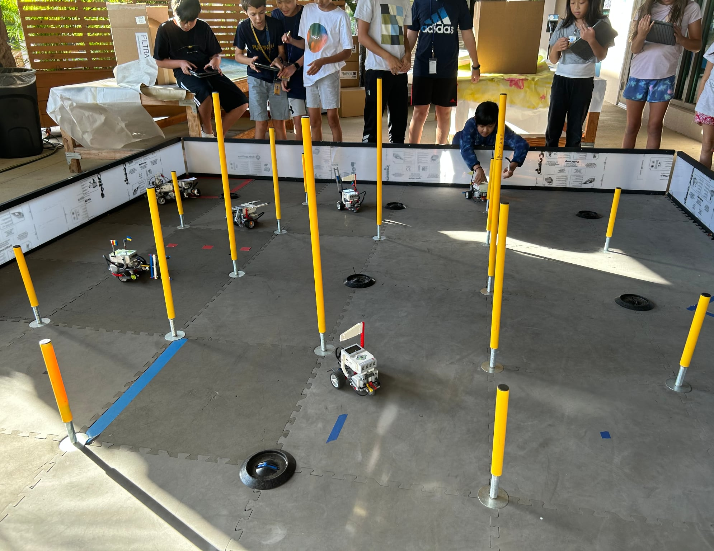
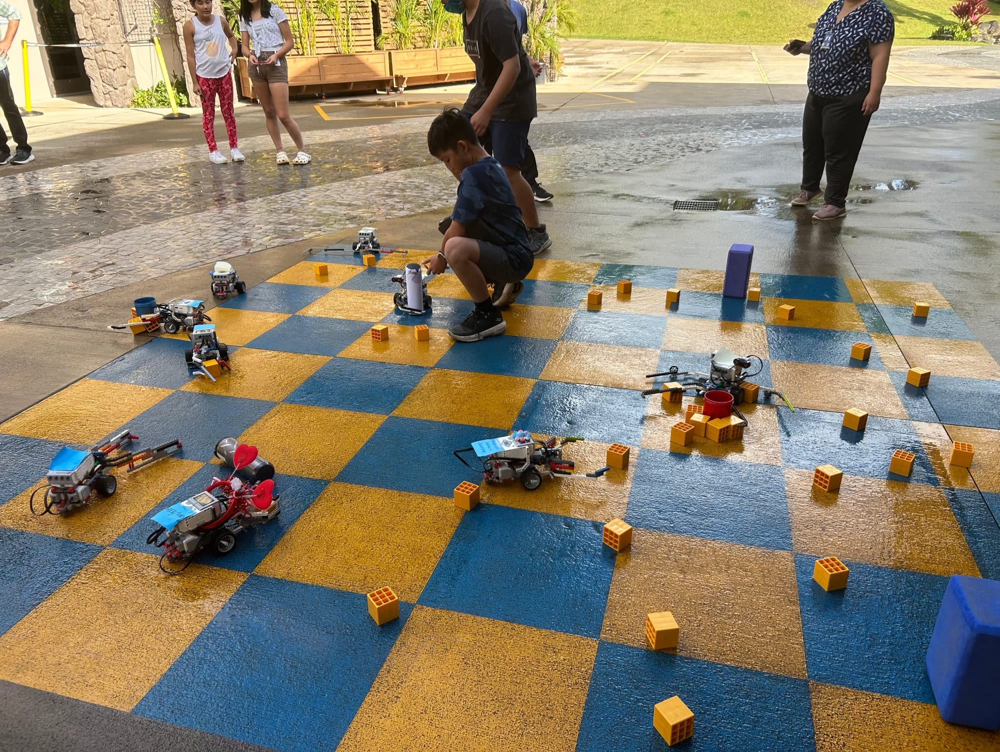

## JR Robotics

Thanks to my mentor, Mr. Loveman, I was given the opportunity to become a JR Robotics TA. Through this TA program, I have been able to connect with Punahou School's future engineering students and share what I have been able to accomplish and what they can accomplish as well. I TA alongside many other Punahou Students who are also involved in Punahou's DTE department and we have been able to connect on that level. Talking with fourth, fifth, and sixth graders, and even high schoolers, has reminded me of the initial spark engineering gave me.

