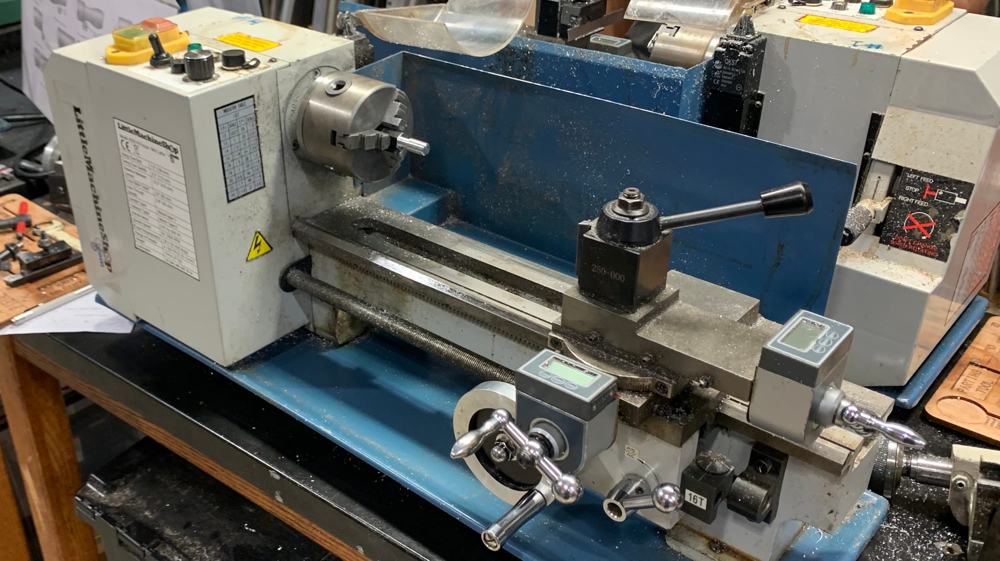
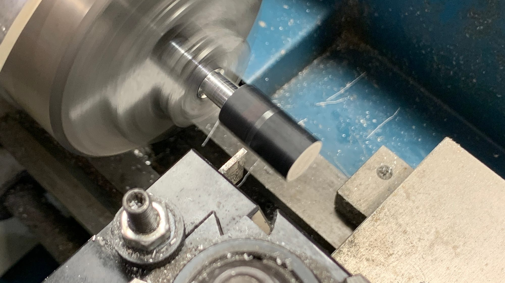
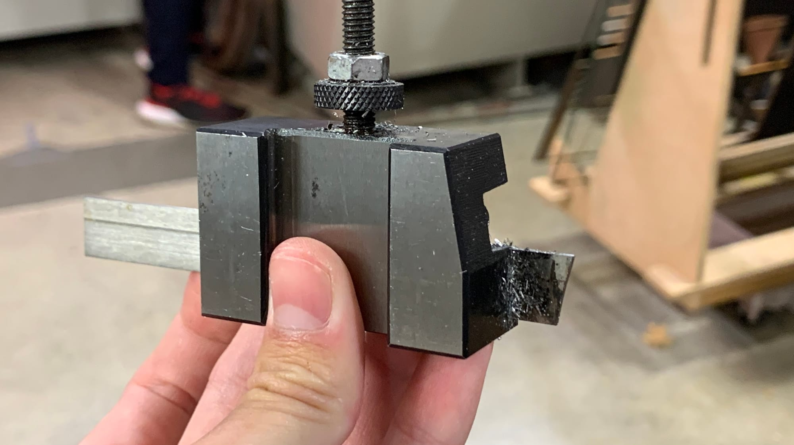
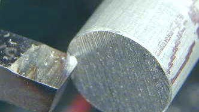
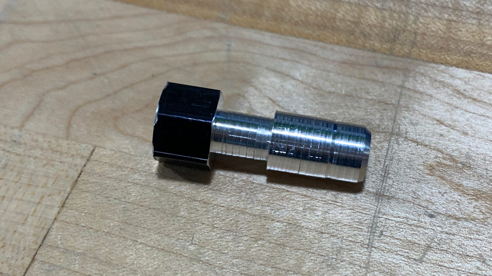

# Lathe

This is the machine that we used for this project. You can add a tool to a spot that can move on the X and Z axes to cut into a piece which you place on the left. We had to make a piece that fit certain measurements with tolerances. The piece we made got us practice using things like facing and parting.

# Process

We used different tools to turn a hexagonal piece into a rounder and smaller shape. This picture is of the lathe spinning and I am using a parting tool to shorten my piece.

## Parting

This is the tool I am using in the picture, I used this one the most to shorten my piece as well as carve out the smallest section.

## Facing

This tool was used to smooth out the front and back. I also used it to shorten the front section of the piece.

# Final Piece

This is my final piece, I made all of the size requirements. On the front/right section you can see a small divot in the piece. I had this happen a few times but this is the only one still there, this was caused by the machine being shaky. While I was cutting the machine would bump and sometimes jut a little too far in. Besides that I think this was a fun project to do!
