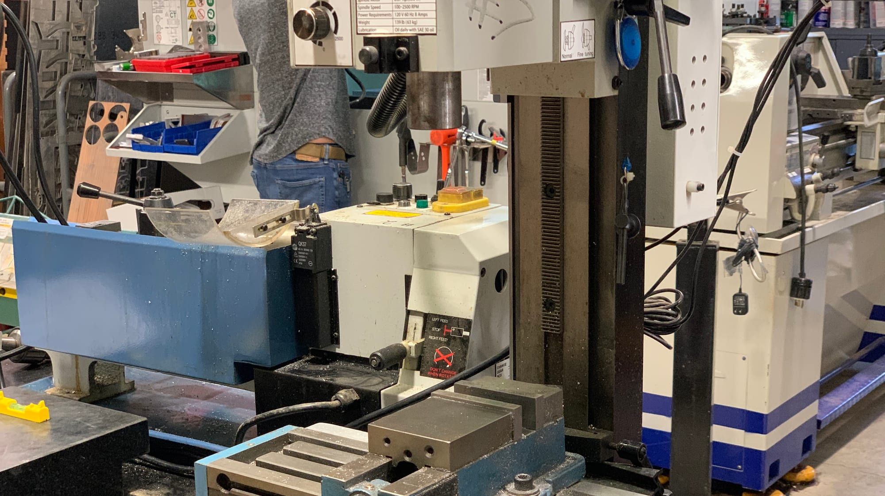
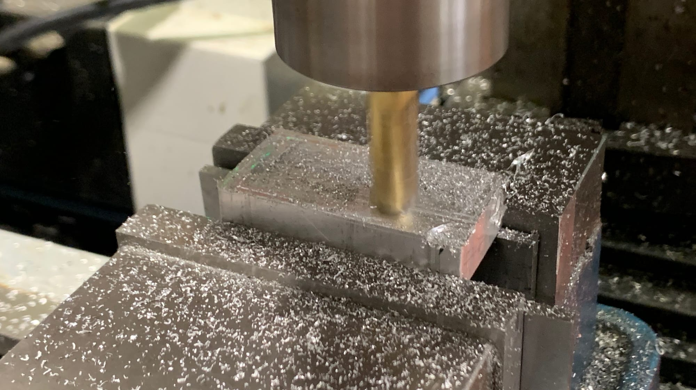
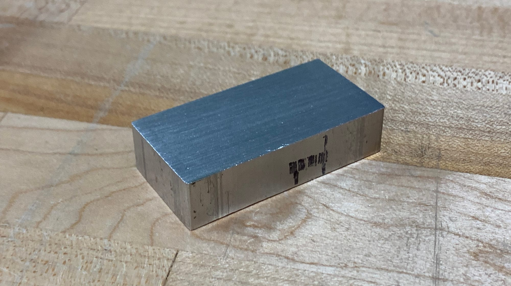
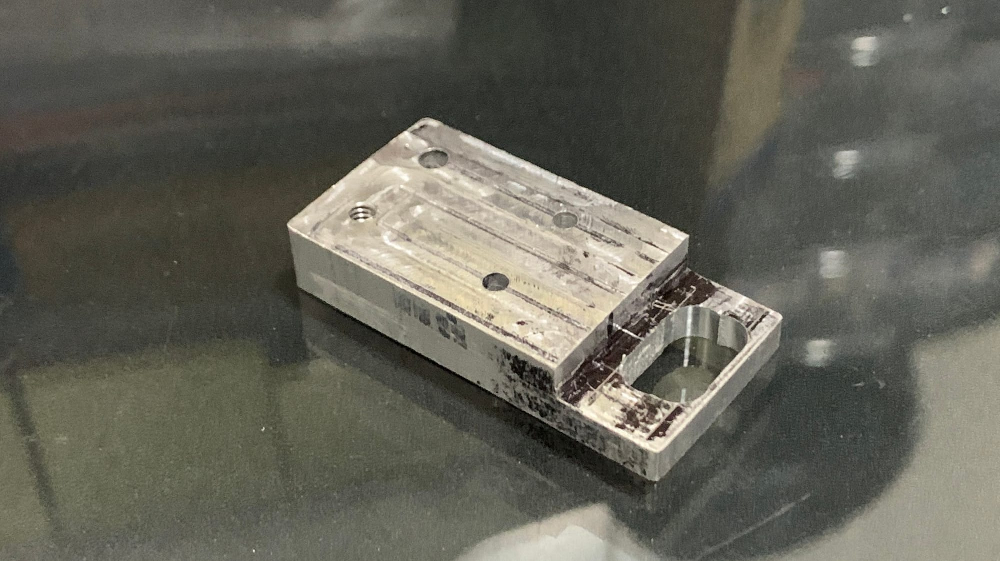

# Mill!

This project was similar to the [lathe project](/punahou/competency-tests/lathe-test/). We were given a piece to make with specific measurements and tolerances. We made a piece that would help us to learn how to use the mill.

# Process

We used various end mills and drill bits to complete the different sections of this piece. In the picture on the left, I am using a larger end mill to take off some height and get closer to the required measurement.

## Beginning

I did not take enough pictures of the process because I was focused on finishing within the small time we had. This is what the original piece looked like, it was cut a little big to give margin for error.

## Final Piece

To make this final piece, I continued to use a larger end mill to create the dropped-down section. After that, I used small drill bits, 7/64 and 9/64, to create the holes on the top of the piece. I then went to a medium-sized drill bit to create the hole on the lower part. Once I finished that, the last thing to do was tap the holes, giving them threads so a screw can be used. My piece met the measurements everywhere except for the hole on the lower part, where I struggled to line up the edges as I went back and forth slowly drilling into it. Besides that, this piece was really fun to make!
