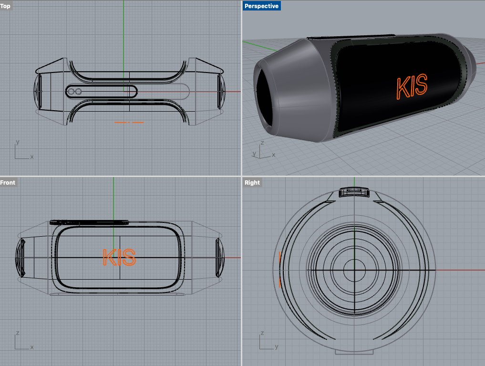
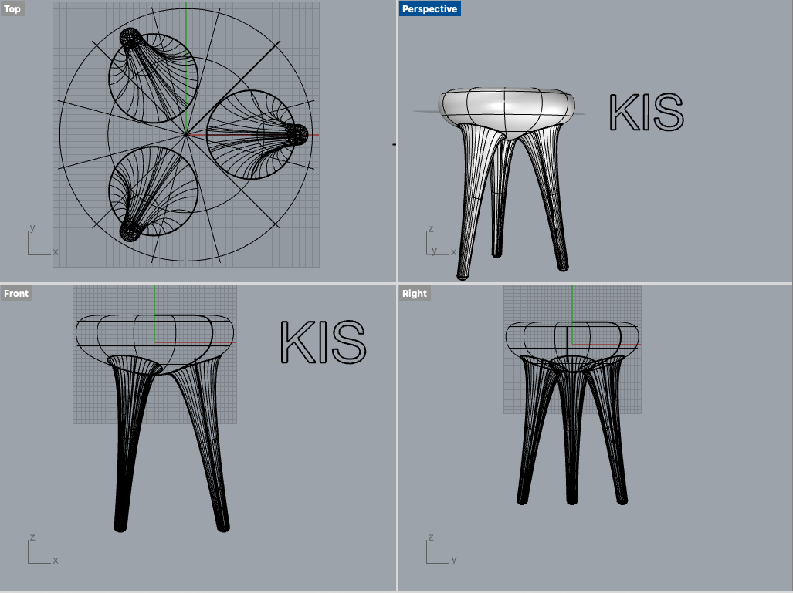
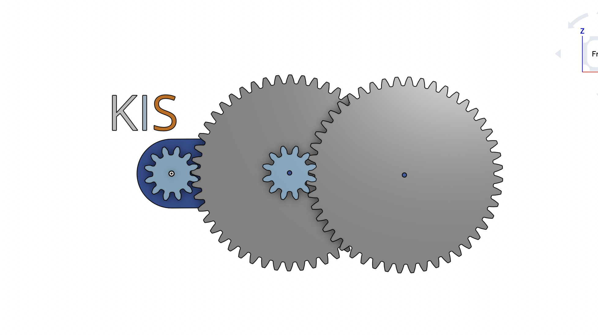

# JBL Speaker

 We were tasked to try to replicate a JBL Speaker by watching a tutorial on how to make it!

# Chair

We practiced our skills to make a chair with three legs.

# Gear

We practiced using tools in OnShape to create gear ratios.

https://www.loom.com/share/dc423b7631d7470a9a552dfc39645ab8 (video on the gears animated)
