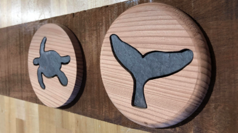
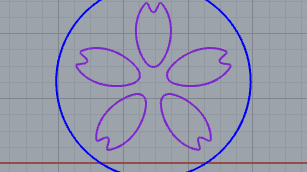
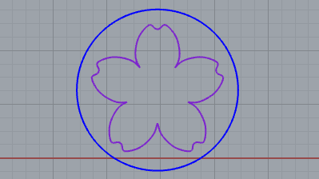
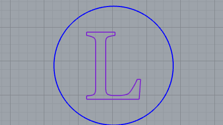
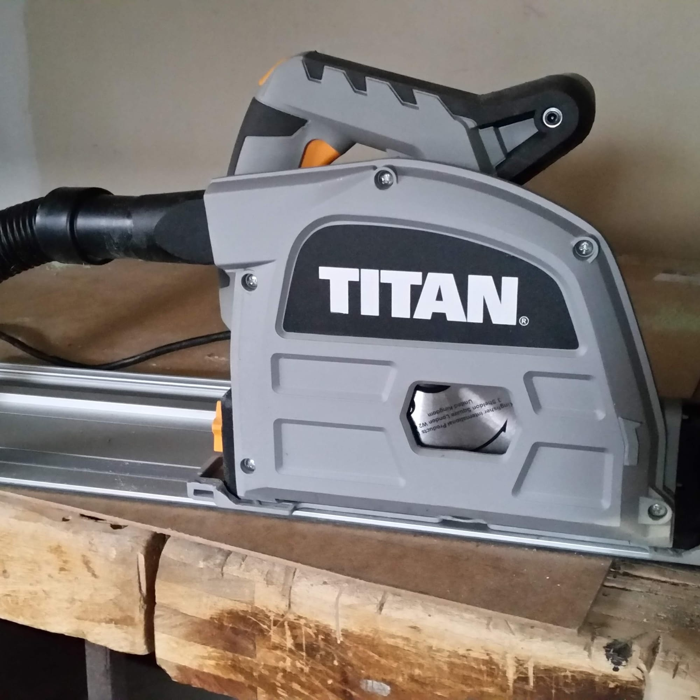
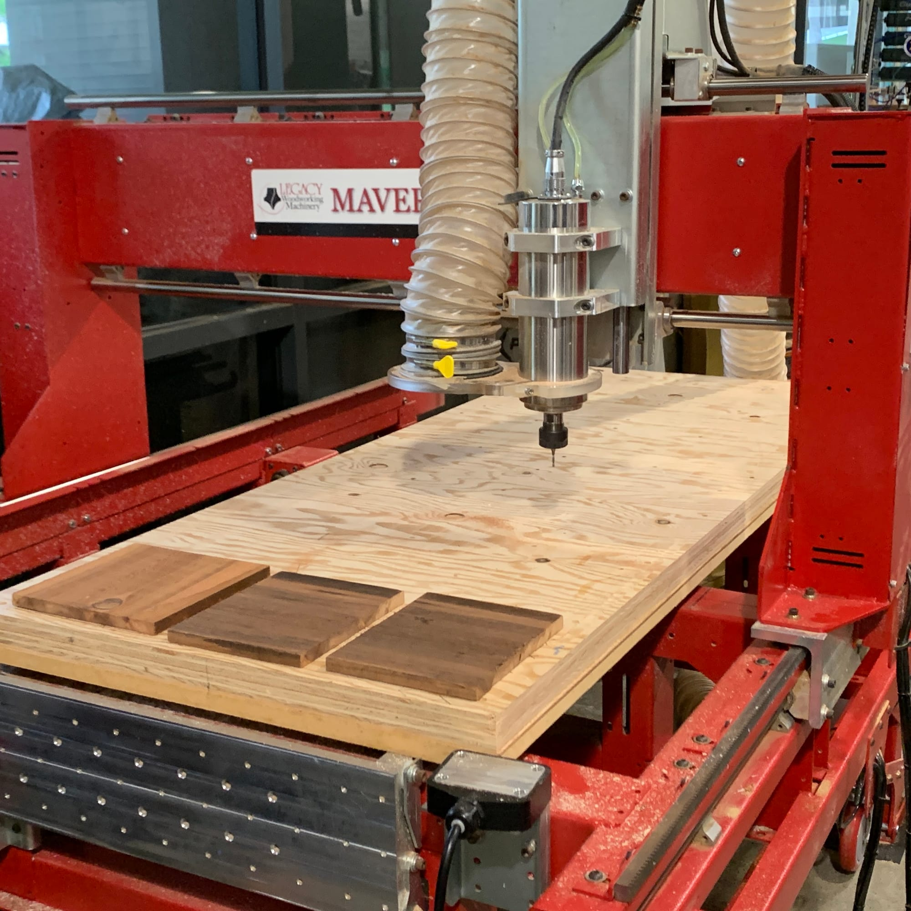
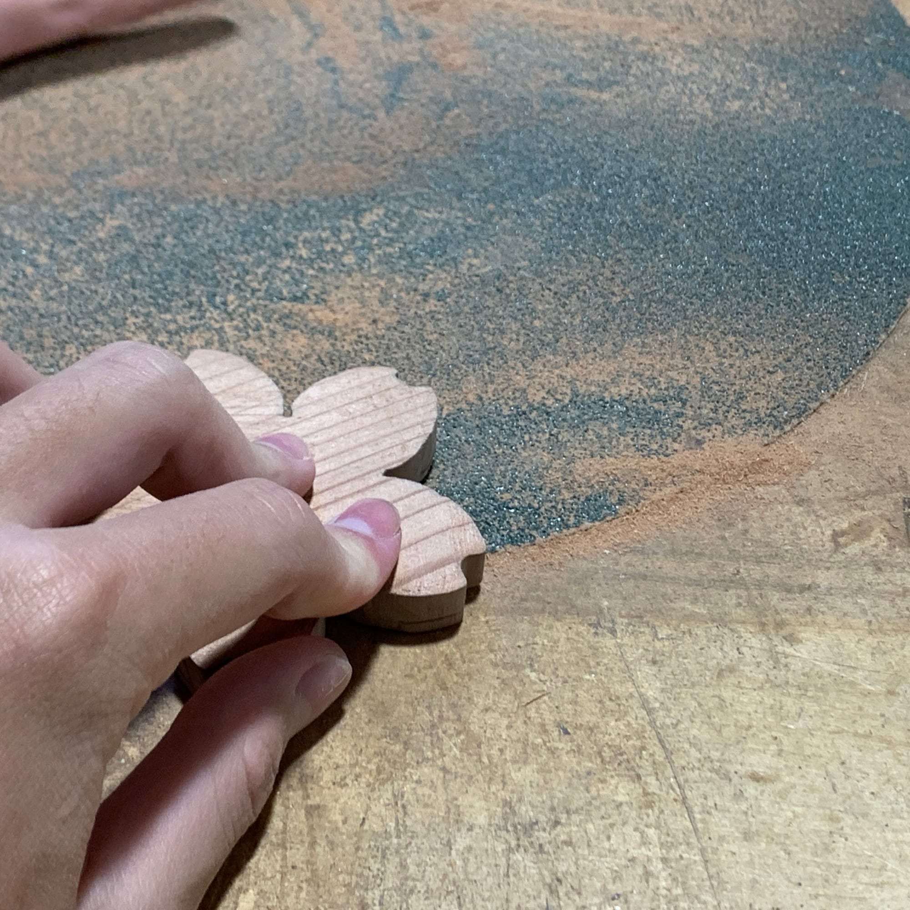
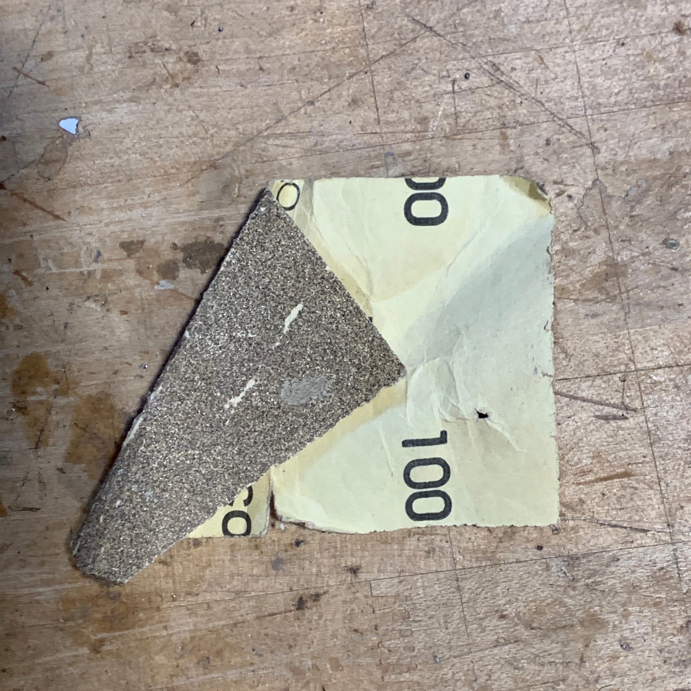
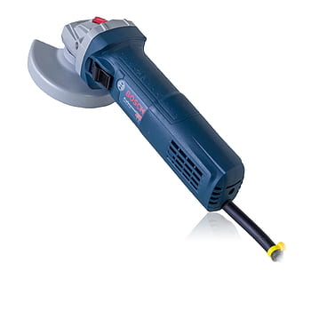
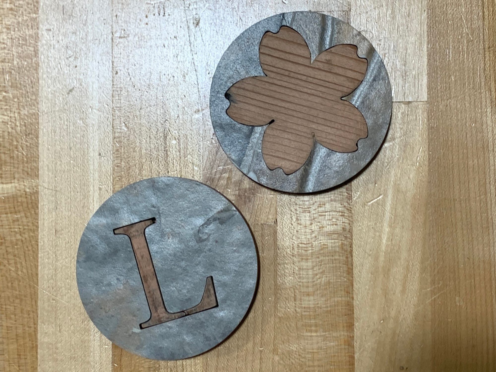

# Making Coasters

This assignment was made to help us get practice using the CNC Router as well as the water jet. We also need to look at kerf to make sure our two separate pieces have a friction fit.

# CAD

## First CAD Design

This was my first design for my first coaster. In the end I didn't go with this design because it was hard to tell it was a cherry blossom, looks more like a sand dollar.

## 桜花(Cherry Blossom)

This was my final design for the cherry blossom, I decided to connect the petals to get a full outline of the flower.

## Letter "L"

I made both of these coasters for my friend and their name starts with an L, so I thought just a nice "L" coaster could be cool.

# CAD to Real Life

# Machines and Process

## Track Saw

We started off using a track saw to cut the wood that we would use on the CNC.

## CNC

We originally planned to use the CNC to cut either the positive or negative but there was a problem with the machine so we moved onto using the water jet.

## Water Jet

With the water jet we cut a tile piece and a wood piece that we combined to make our final tiles.

The pieces I cut were a little too big and didn't fit flush to the tile so I sanded them down with this 60 grit sandpaper.

I then used 100 grit as well as an electric palm sander to help get it smoother and closer to exact.

This was the electric palm sander we used.

# Final Product

# Coasting By...

I think the coasters came out nicely, we finished them off with a corkboard bottom that was cut on the laser cutter. I am happy with the end result. The hardest part was hand sanding each of the pieces down to the right size, this could have been avoided if we planed the wood first but it was at least fixable. I gave them to my friend and they said they looked really cool and that they worked well.
