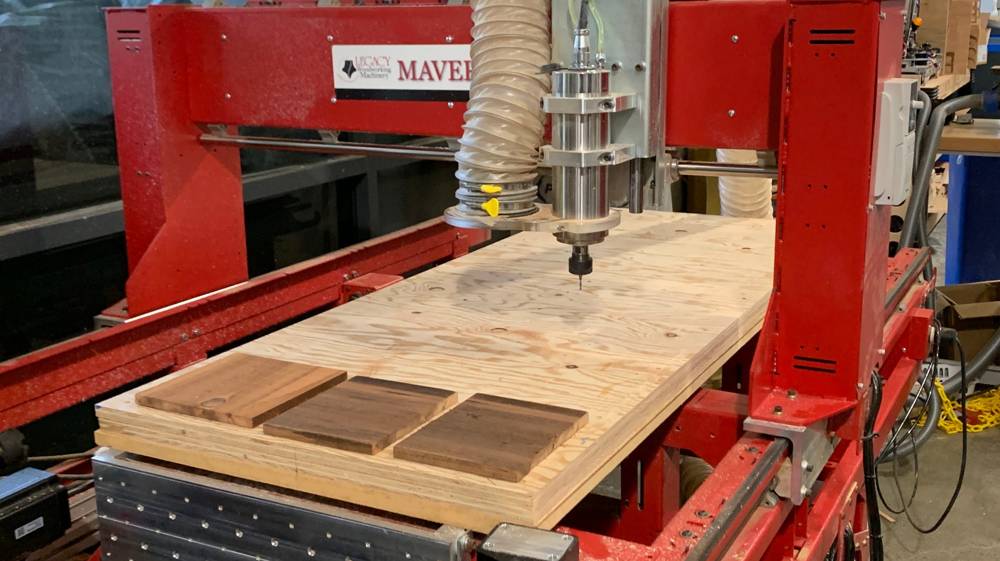
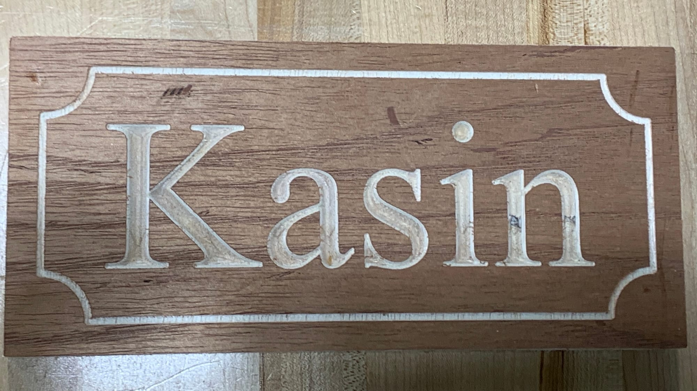

# What did we do?

For this sign project we got to practice creating an Aspire file that could be read by the CNC machine. We used a profiling tool as well as a V-Carve tool to create our sign. I was unable to find what the CAD looked like but it is easy to see on the sign itself.

# Machine

# CNC

We used two bits on the CNC to get our final sign design, a 1/8 in. bit and a V-Carve bit. The V-Carve cut out the name while the other bit made the border and cut out the sign at the end.

# Sign Cut Out!

# What's my name?

I think the end product came out really good. There was one part when the wood that I used was a little too small and when it was going to cut the sign it barely cut anything off. In the end, I think it was a helpful learning experience.
