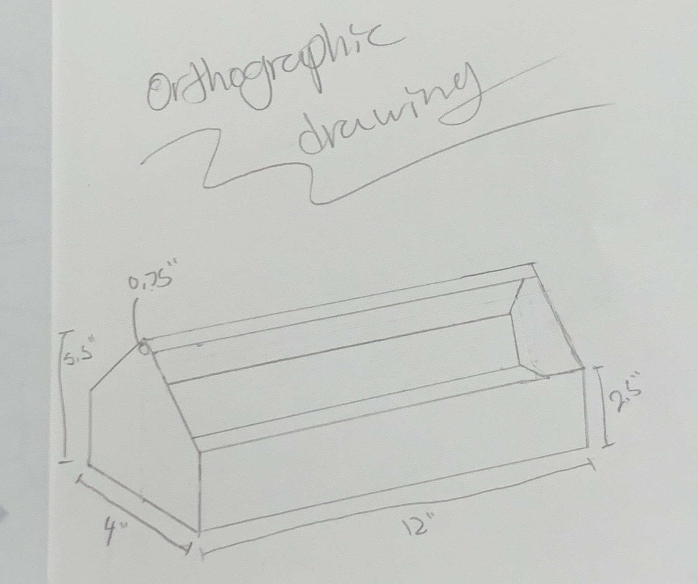

# Orthographic Sketch

We drew the toolbox in a 4:1 ratio.

# CAD

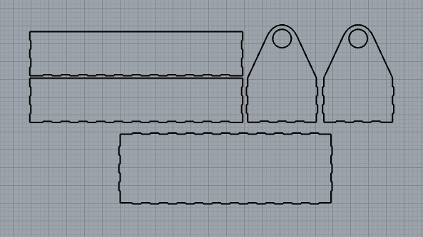

# Sketch to CAD

This is the sketch layout of the various toolbox parts. I later turned these into actual pieces for a real tool box. (Rhino)

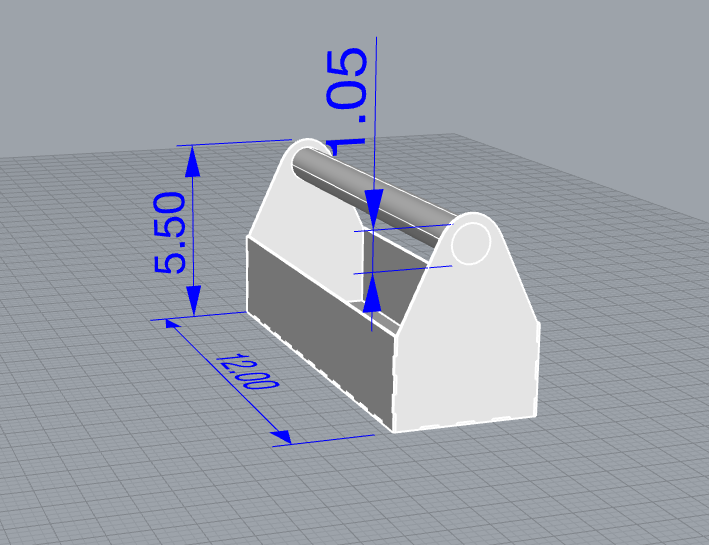

# CAD Model

This is a model of how it should look in real life. The long cylinder became a PVC pipe. (Rhino)

I planned to make this out of aluminum with a friction fit and a PVC pipe as the handle.

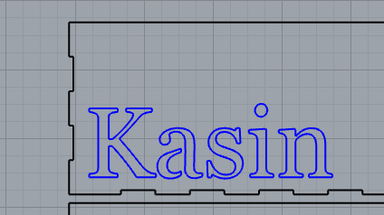

# Text Design

This was for the side of my tool box!

# CAD to Real Life

# Machines

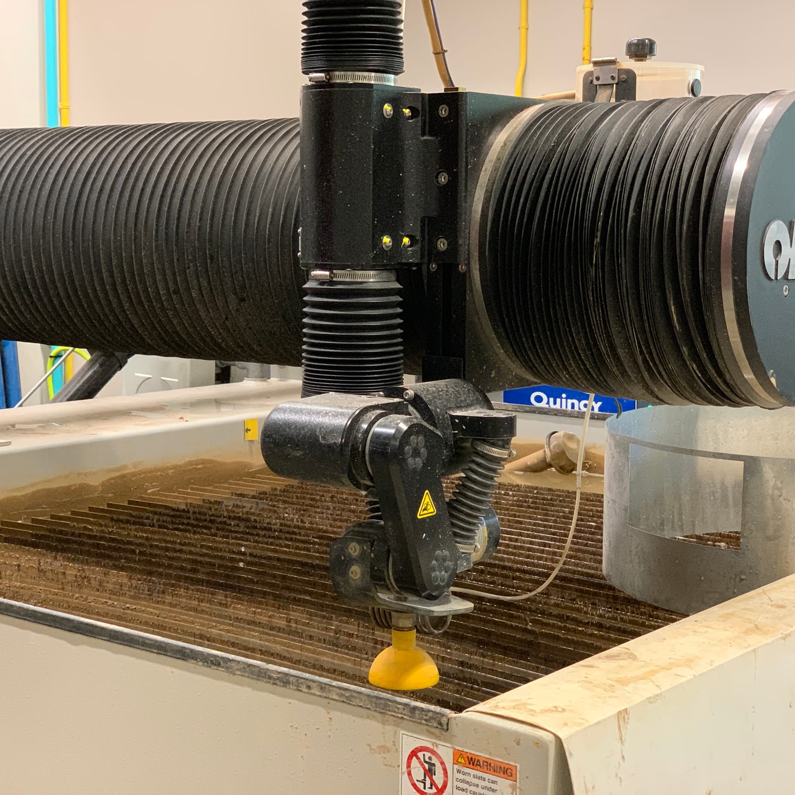

## Water Jet

We water jetted out each piece of the tool box.

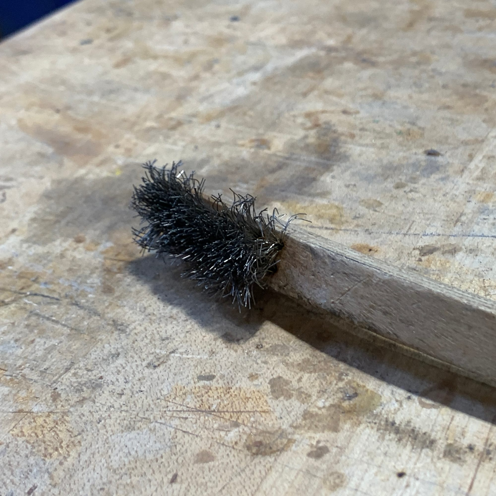

## Wire Brush

We used a wire brush to clean our pieces so dirt and other things would not become a problem.

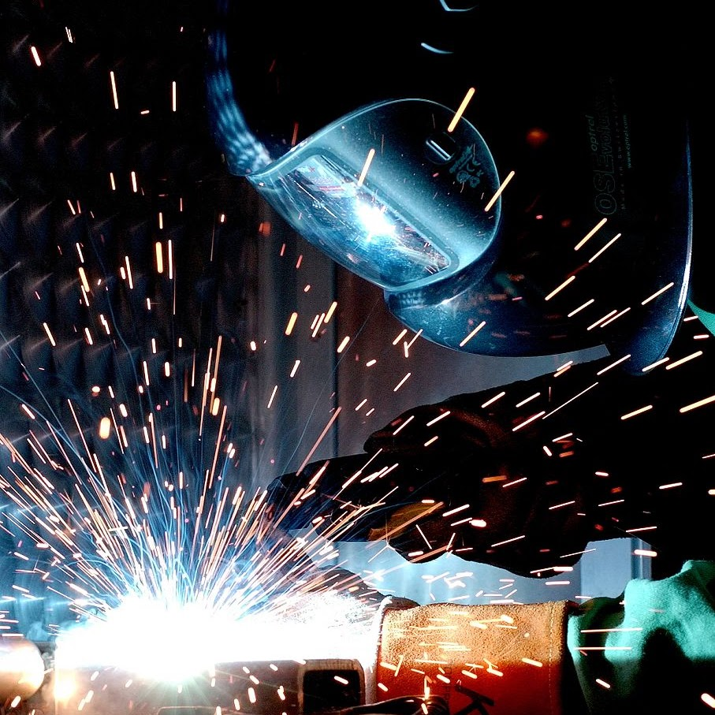

## Welding

We welded each piece together.

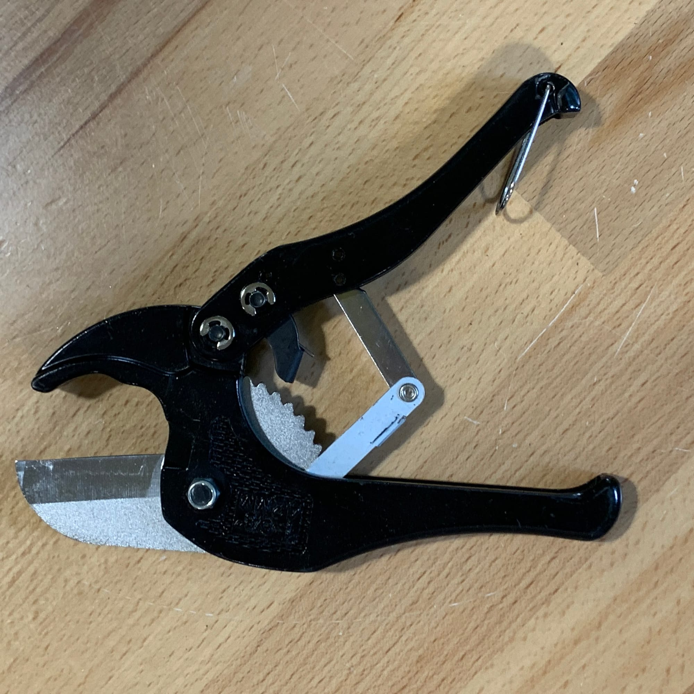

## PVC Cutters

I used this to cut the PVC pipe down to the right size

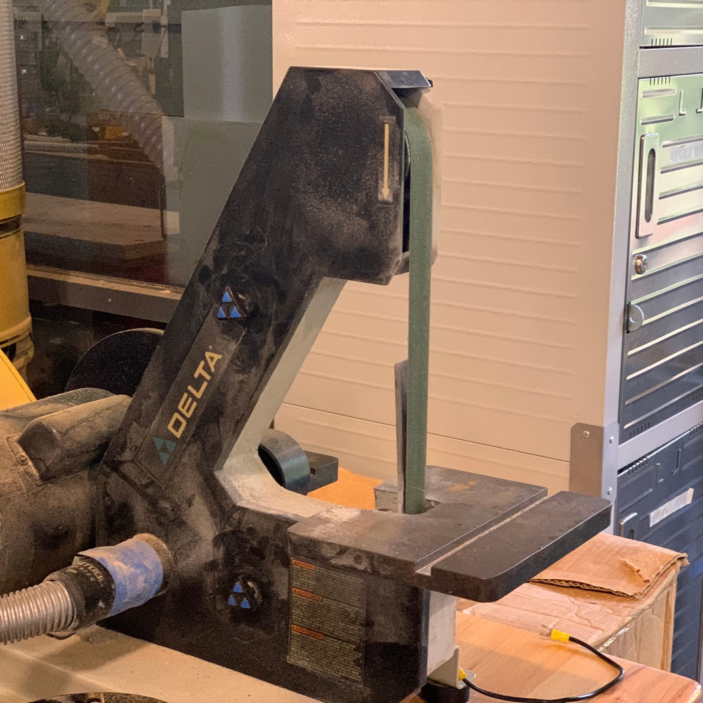

## Belt Sander

I used this to make my PVC pipe a little bit smaller to fit into my box

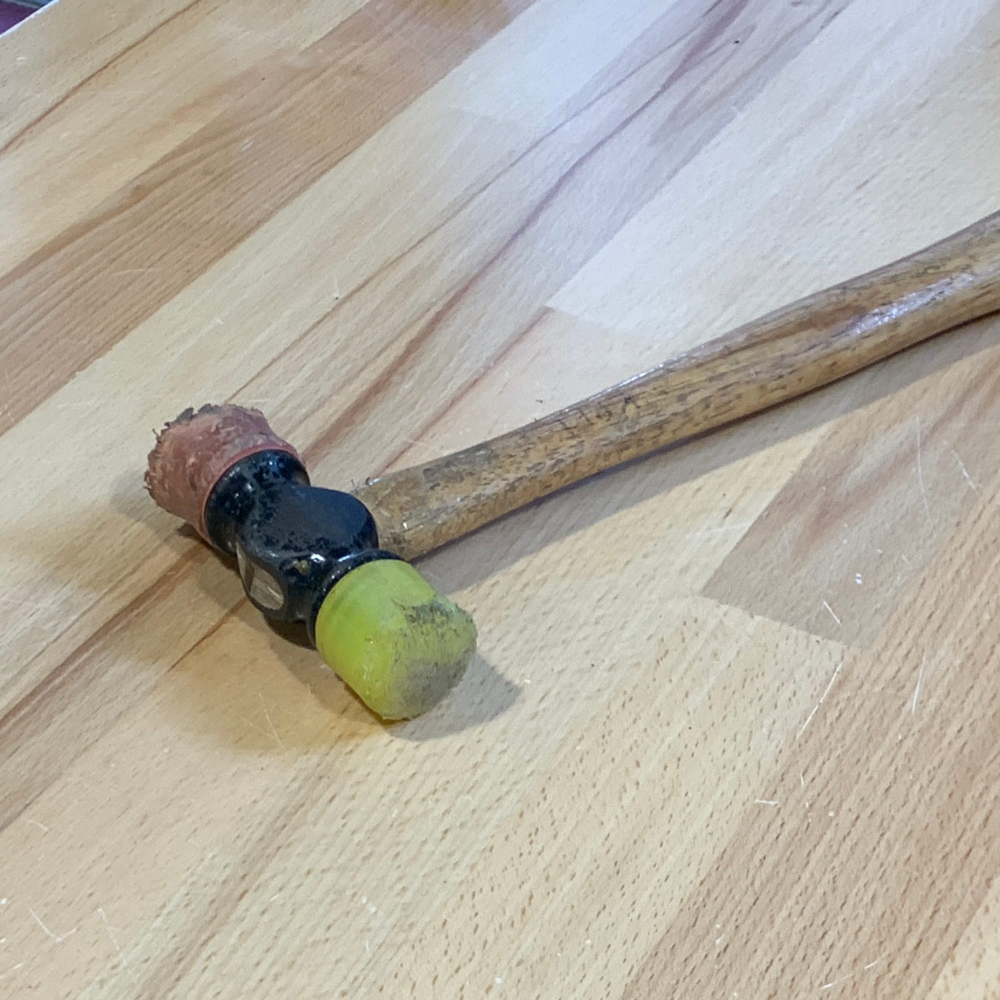

## Mallet

I finished the box off by malleting the PVC pipe into the two end holes.

# Put together!

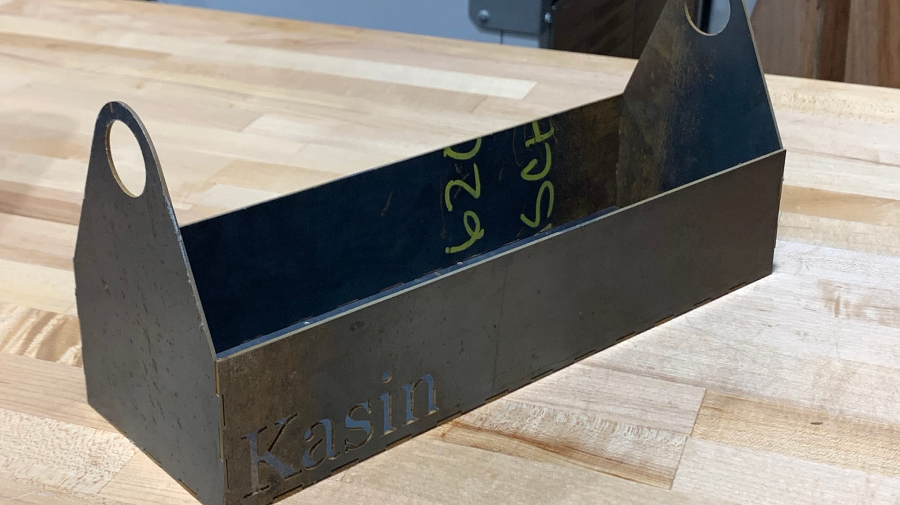

# Piece to Piece

These are my pieces of my tool box put together. They still needed to be welded and cleaned for the final piece.

# PVC

This is the PVC we used for our handle. I cut it with the PVC cutter above and then slid it in between both ends of the box.

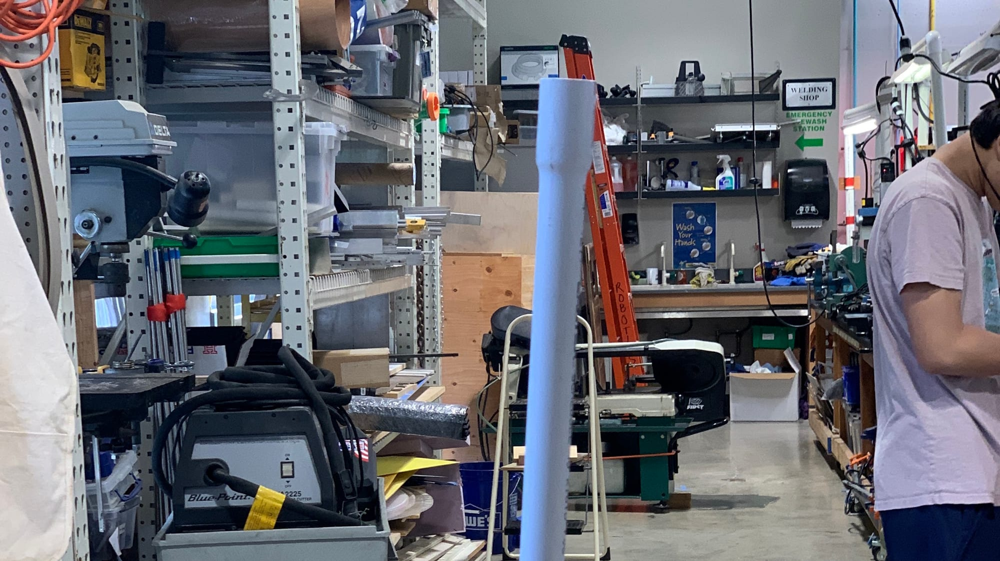

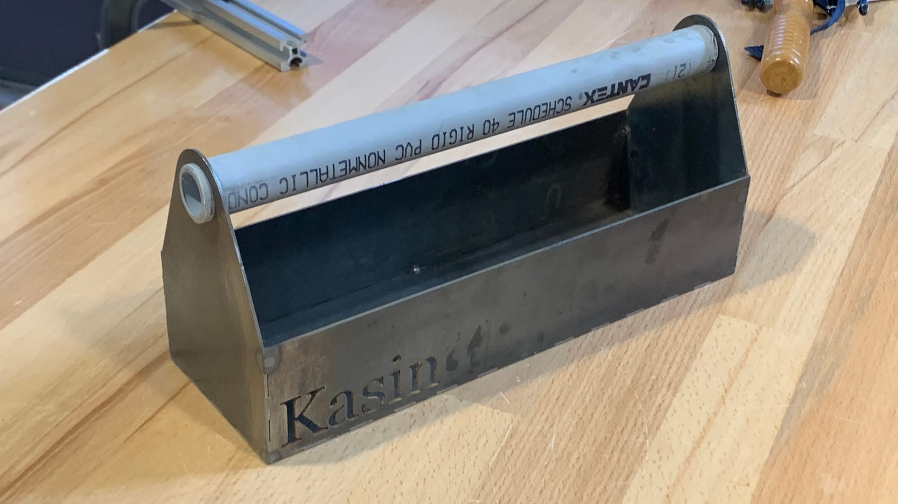

# Welded!

This is the final box, welded and with a handle. You can see some of the heat marks from the welding on the corners and some tacks inside!
