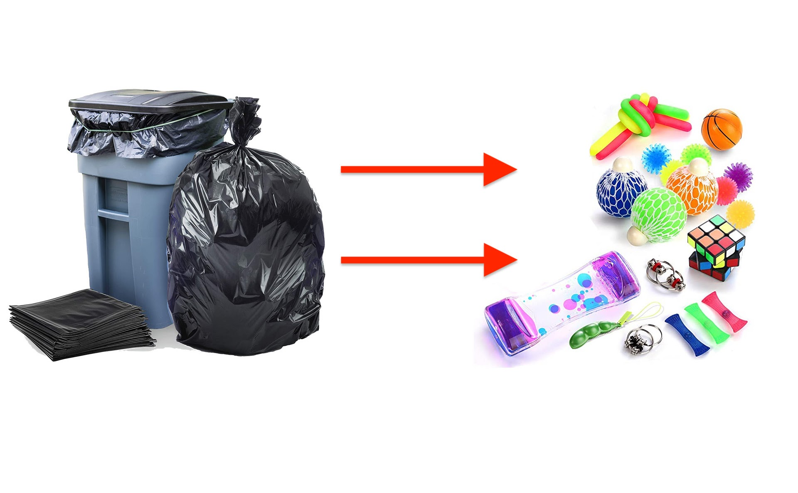
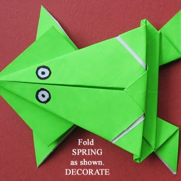
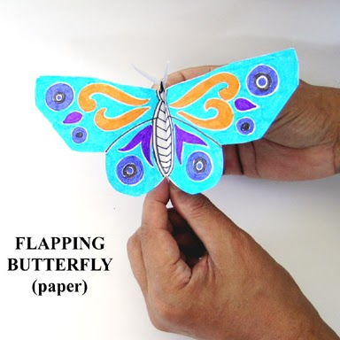
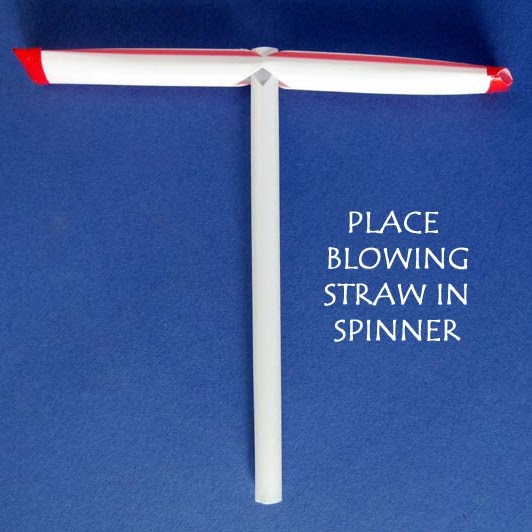
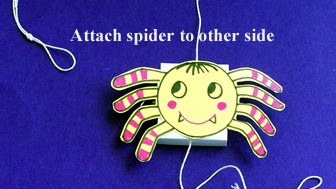
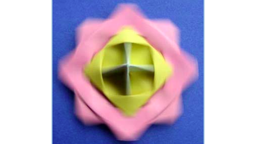
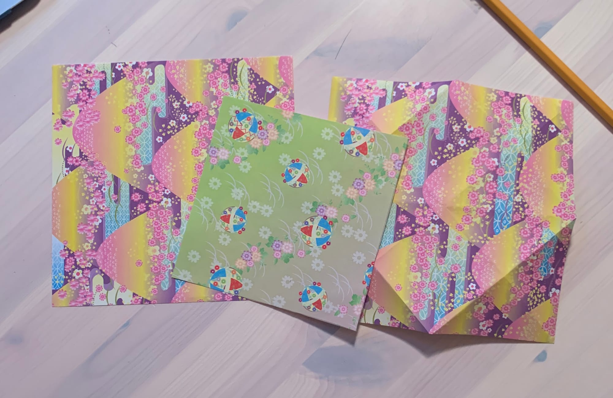
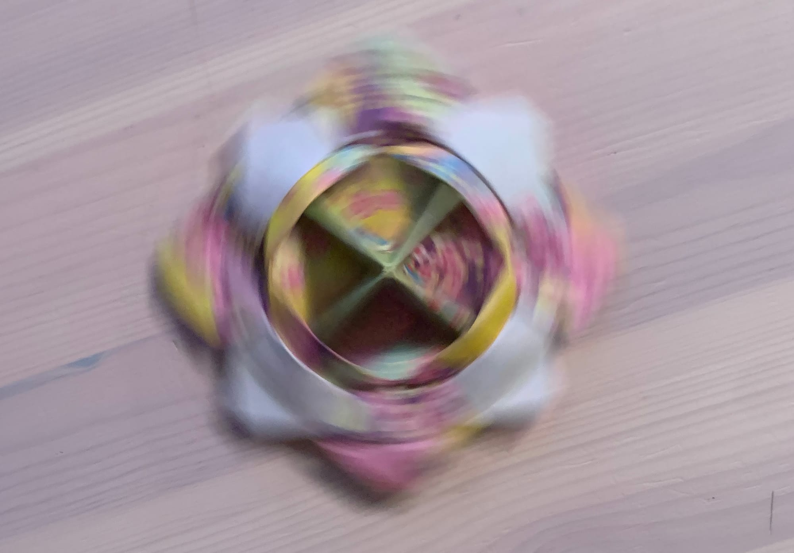

# What is this project?

While at home we are trying to use household items, "trash", to make a toy. Our first step was to make an "Inspiration board" with ideas that we could do.

# Potential Ideas

## Jumping Frog

http://www.arvindguptatoys.com/toys/frog.html

The frog looked cute and I thought it would be cool to have something able to move.

## Flapping Butterfly

http://www.arvindguptatoys.com/toys/flappingbutterfly.html

Pretty simple to make and the movement could be interesting.

## Straw Spinner

http://www.arvindguptatoys.com/toys/sspinner.html

Easy to get materials and a fun to look at end product

## Moving Spider

http://www.arvindguptatoys.com/toys/spider.html

Cool concept to use with the string and how it moves.

## Spinning Top

http://www.arvindguptatoys.com/toys/papertop.html

Fun use of origami that ends up with a cool looking end product with motion. (I chose this one!)

# Paper Top Materials

  - Two Pieces of Origami Paper

  - 2/3 Sized Piece of Origami Paper

http://www.arvindguptatoys.com/toys/papertop.html

# Process

  - Cut one normal sized piece of origami paper into a 2/3 sized one

  - Follow the instructions on the left

  - Have fun!

# Final Product!

# Paper Top

It spins!
