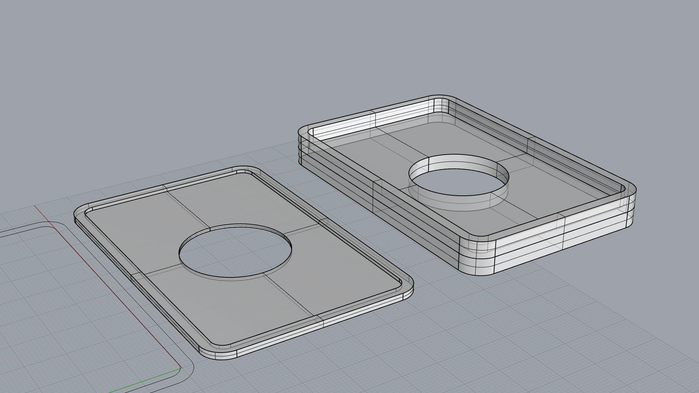
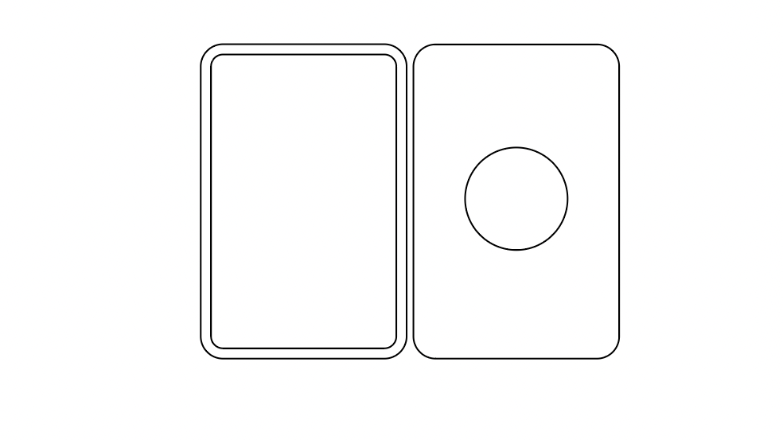
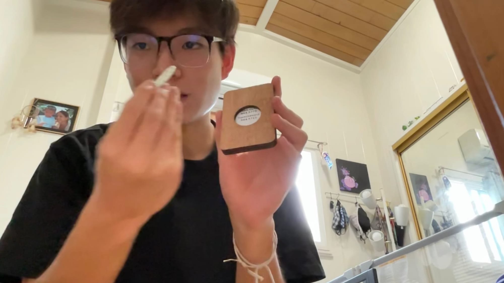

# ID Card Template

I worked alongside Punahou School's IT in order to create an ID card template that they would use on admissions day to make the process much faster and more consistent. The design aimed to make it so the chip they needed to place on the back of each ID would be even and not cover any important data.

# Final design

I initially started with the design to be 3D printable however we found that the laser cut design was much more consistent and faster to produce. We decided to go with the laser cut design and I created 25 units!

Final Design!

Where the chip goes!
