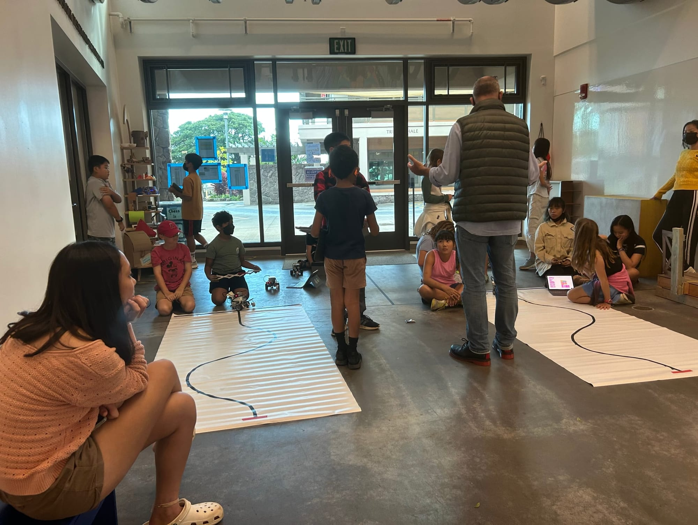
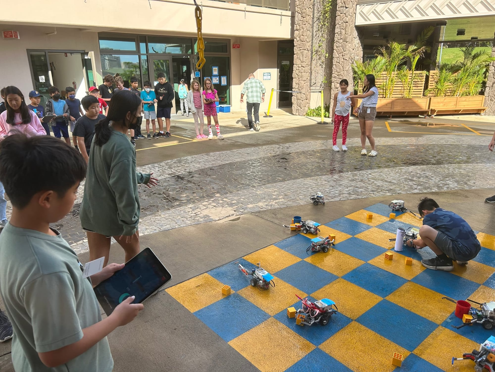

# JR Robotics

Thanks to my mentor, Mr. Loveman, I was given the opportunity to become a JR Robotics TA. Through this TA program, I was able to connect with Punahou School's future engineering students and share what I had been able to accomplish and what they could accomplish as well. I was a TA alongside many other Punahou students who were also involved in Punahou's DTE department and we were able to connect on that level. Talking with fourth, fifth, and sixth graders, and even high schoolers, reminded me of the initial spark engineering gave me.

