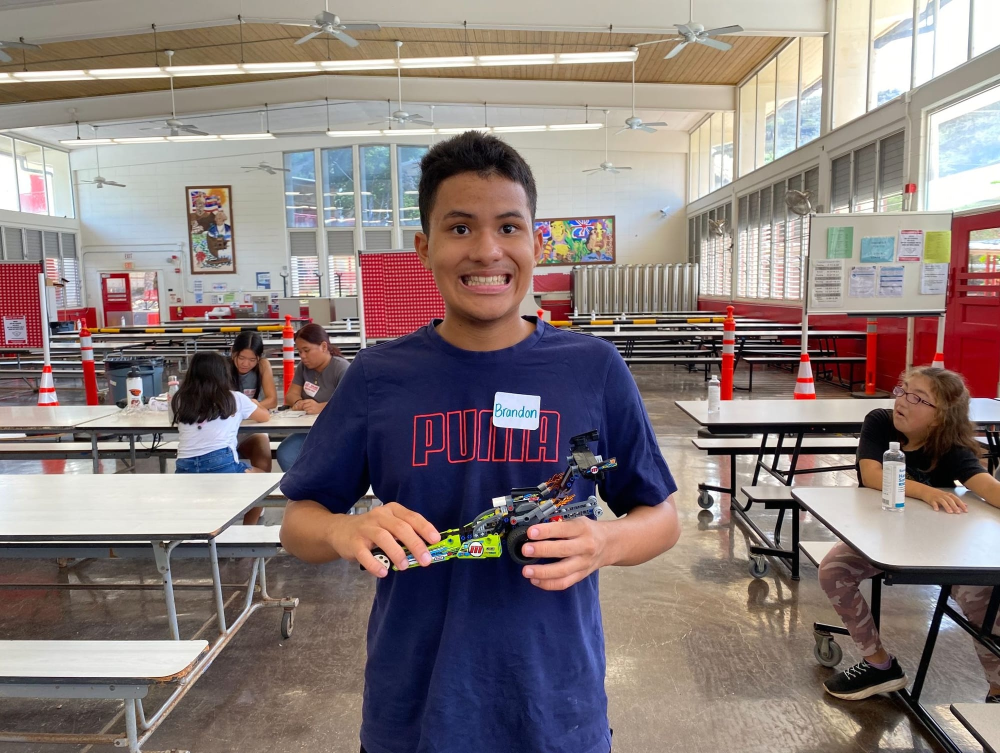
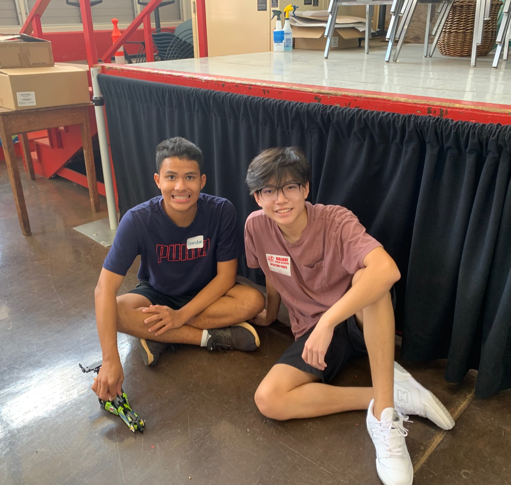

# Building Legos

I have worked with the Kalani High School Special Needs Program in helping to give the students exciting experiences. On this occasion I aided the students in building a lego car. I worked with a student and let them take the reins, only stepping in when something went wrong.

# Connections

Working with these students showed me the responsibility I have to use what I've learned to help others. Using engineering to help others rather than only myself has really changed my outlook on this passion of mine. I aim to continue to support the communities that I am a part of as well as those that have supported me in the past.

