# How do we make a Jewelry Box?

To complete this project we had to use the "Design Thinking Process" (shown on left). We are going through each step to create a jewelry box that a "client" would want. We empathized through empathy interviews with our client. Define by coming up with ideas that meet the needs of our client then ideate and sketch out the idea. We then will revise on those steps if a better idea is proposed. Then we will bring these ideas into RHINO and prototype parts for a music box and the other parts of the box. Then we will test how the client likes the ideas and how they look, and if not, we will revise.

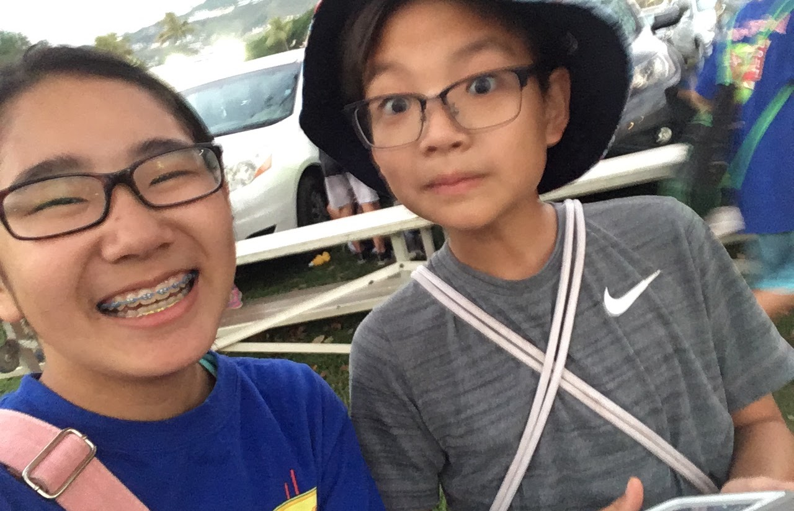

# Empathy Interviews!

I will be making my friend, Lindsay, the jewelry container. I will hold a short interview and ask her about what her basic wants and needs would be!

# Interview Questions & Answers!

Interview Questions:

1. Hi, may you look at this website and find a style that you like the best (https://blog.froy.com/interior-design-styles-8-popular-types-explained/)

2. What would you like to be able to put in the box?(ex: Bracelets, Necklaces, rings, etc.)

3. Also, how would you prefer things like necklaces or bracelets to be displayed?(ex: Hung, In a drawer, etc.)

4. Would you prefer one larger compartment and a few smaller ones or a lot of smaller ones?

5. Also, color palette?(ex: like wood no paint, paint(pastels or brighter colors, leather, etc.)

6. Would you like a mirror?

7. Do you want the box to have legs or skirt?

8. What shape would you prefer?(ex: boxy, circle, oval, etc.)

Interview Answers:

1. Urban Modern!

2. Bracelets, Necklaces, and Earrings.

3. Hung and in drawer both sounds good!

4. One larger and a few smaller

5. Either pastels or maybe wood both would be nice!

6. If you think it will look nice then yes!

7. Legs...? Doesn't need.

8. Boxy!

# What do we need to include?

The main features that are needed are one larger drawer/space with some smaller drawer areas. There will need to be spaces to hang necklaces as well as spaces for earrings and bracelets. The style will be Urban Modern, so I think something lighter colored and maybe similar in shape to the box on the right. A few design challenges that I foresee would be making the box fit the requested style. I also think spacing things out nicely will be a challenge.

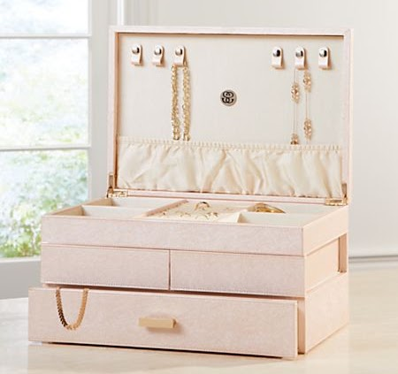

# Sketchy Business!

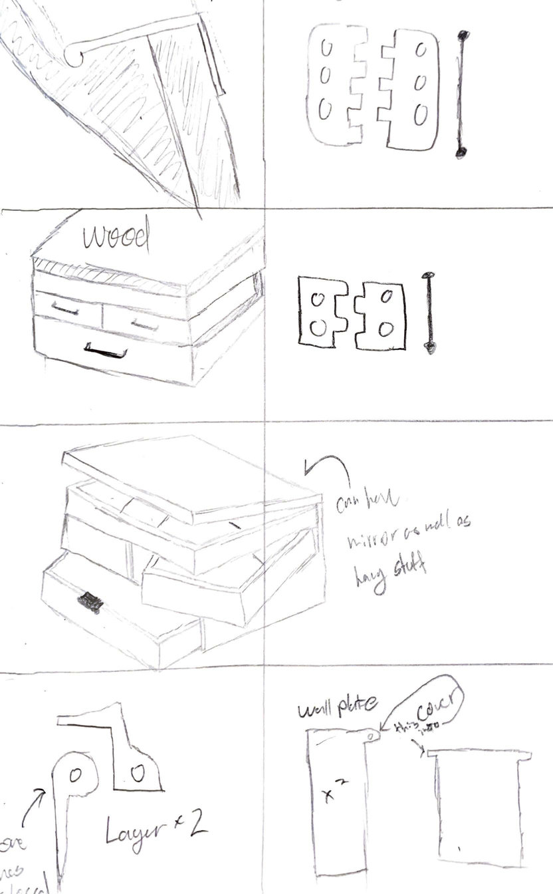

(box and hinge sketches)

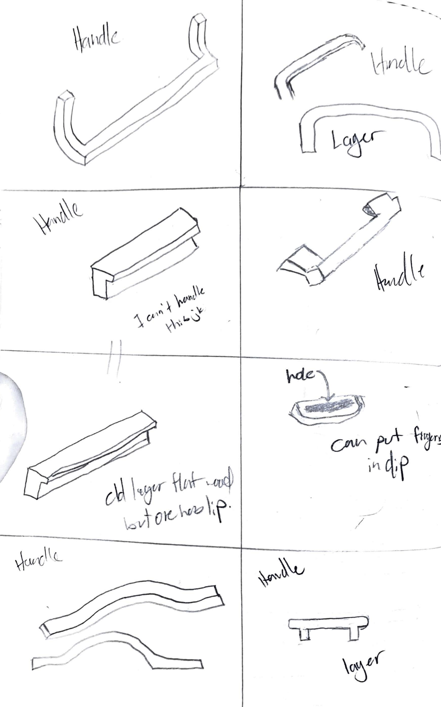

(handle sketches)

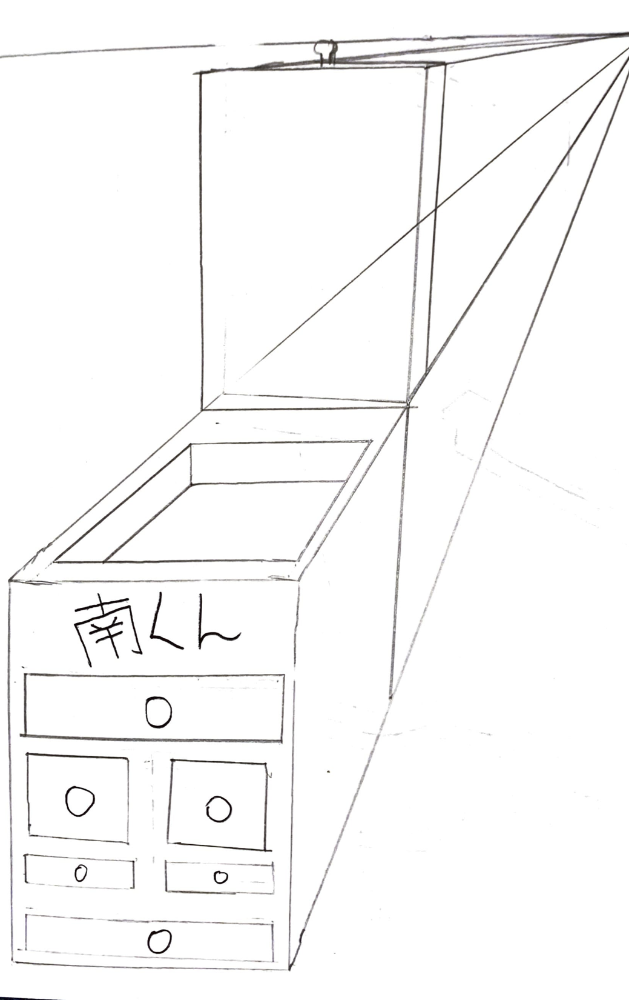

(idea of what box could look like)

# CADing Time!

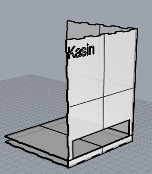

## Practice Drawer and Box Making!

This is what my practice for the actual jewelry box looks like! We practiced getting the various sides of the box using a program called MakerCase. We also learnt how to make a drawer and the base so the drawer won't just fall through the box.

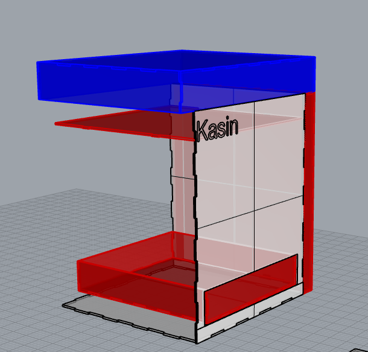

## Part 2...

we learnt how to make a lid as well as the side compartments! We also made the drawer to go into the drawer holder! I will be adding these features to my jewelry box in the coming future!

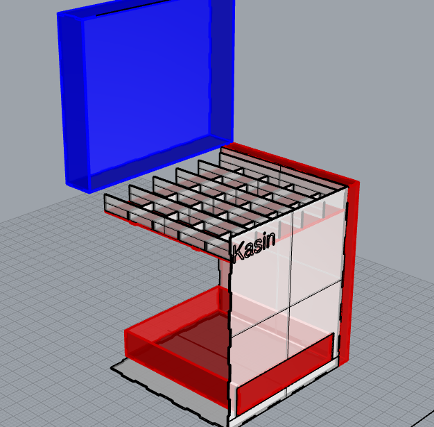

## Compartments!

We learnt how to create the compartments to store the jewelry. We used the array tool to easily duplicate the dividers evenly. There will be compartments in each drawer with varying sizes.

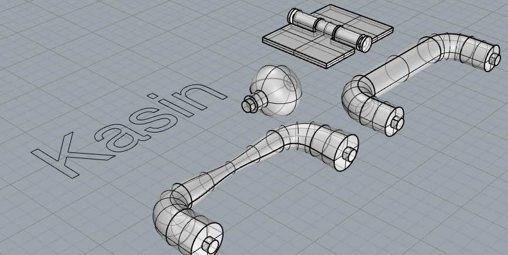

## Knobs, Handles, and Hinges!

We learnt how to make a hinge, a knob, as well as a handle. There are two different handles so we could practice using creative liberty. The hinge is made to be easily 3-D printable.

# Practice into Product!

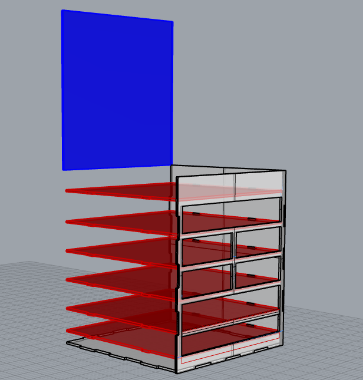

# Basic Layout

This is the shape and layout I will be going for with my box. There is an open pocket at the top with a lid(blue). There are three larger drawers and four smaller ones. The red parts are the shelves to hold the drawers so they don't just fall down. I still need to create hinges, handles, and the side opening compartments.

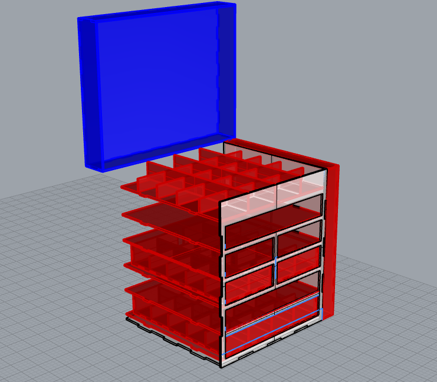

# Work In Progress!

The methods we learned previously on the full box!

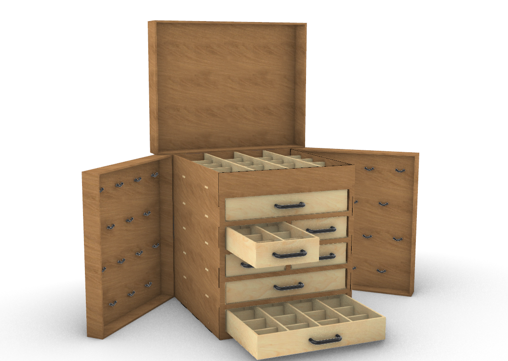

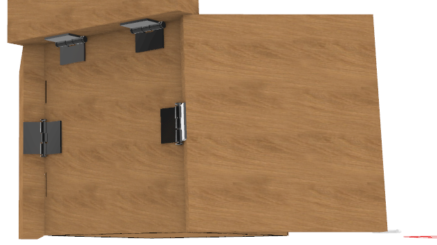

# Finished Product!

This is my finished jewelry box! I used oak for the outside and birch wood for the drawers. The handles hooks and hinges are made from plastic. I have seven total drawers with four small and three big. I also have two side compartments along with one large top compartment at the top. I made this for Lindsay and I tried my best to listen to her feedback and get her the features she wanted. I am proud of this work and it is the first time I took my CAD and placed it all together into a piece within RHINO. I have always just done it through prototyping so this was a fun learning process. I think that we would not have done something like this if this Corona Virus pandemic had not started so this is one positive. The methods and things I learnt will be very useful in the future and I am excited to see how I can use them. A lot of the parts that we created are also very useful in creations that we can make in the future. I think that this was a fun assignment but I am sad we will not be making this anytime soon nor our previous project.
