# Toy Project

# What is the Toy Project?

To complete this project we had to use the "Design Thinking Process" (shown on left). We went through each step to create a successful toy for first graders. We empathized through empathy interviews with first graders. Defined by coming up with a toy idea, then ideated and sketched out the idea. We then went back on those steps if a better toy idea was proposed. Then we brought these ideas into RHINO and tried many different variations to prototype. Then tested how the kids liked these ideas.

# Empathy Interviews

I interviewed four kids total who all loved toys (two shown on left). Some of their favorite toys were legos, action figures, barbies, and, of course, their iPad. What I was able to get out of these interviews was that they really enjoyed making their own toys or pieces of a toy like you would do in a toy like legos. They were all also really into animals and one of the girls I talked to really liked Jungle animals. This information gave me the inspiration for my first toy idea.

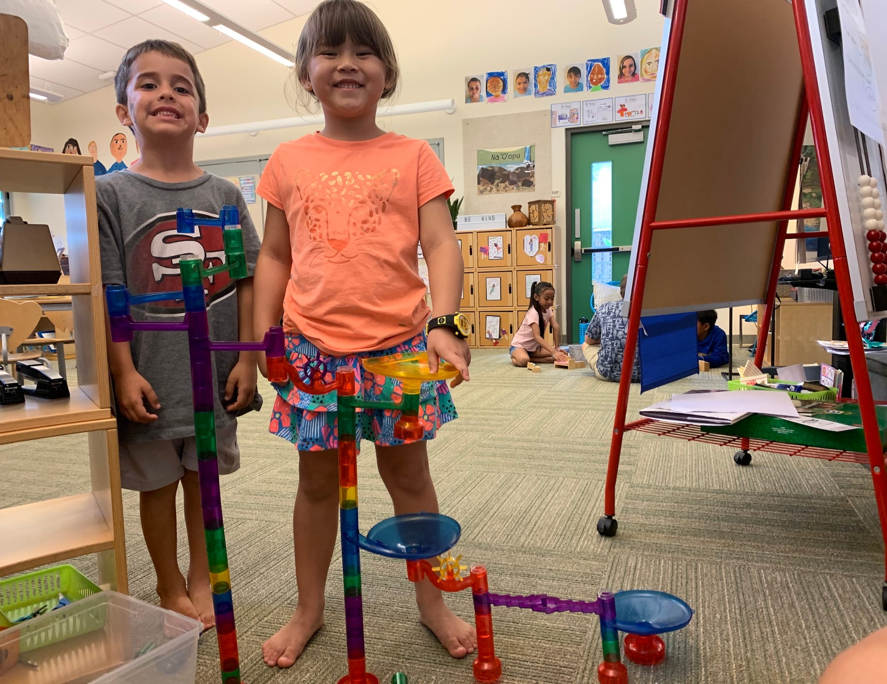

# "Magnamals!" (name by Asher H.)

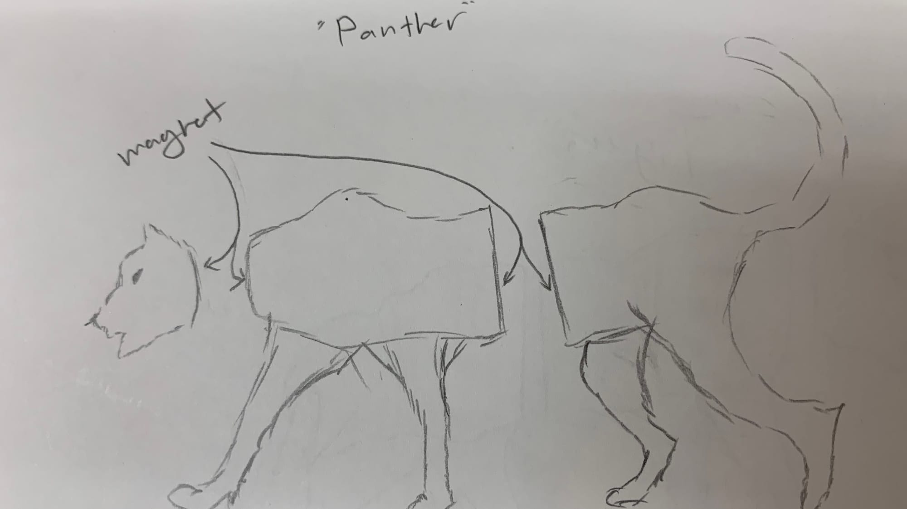

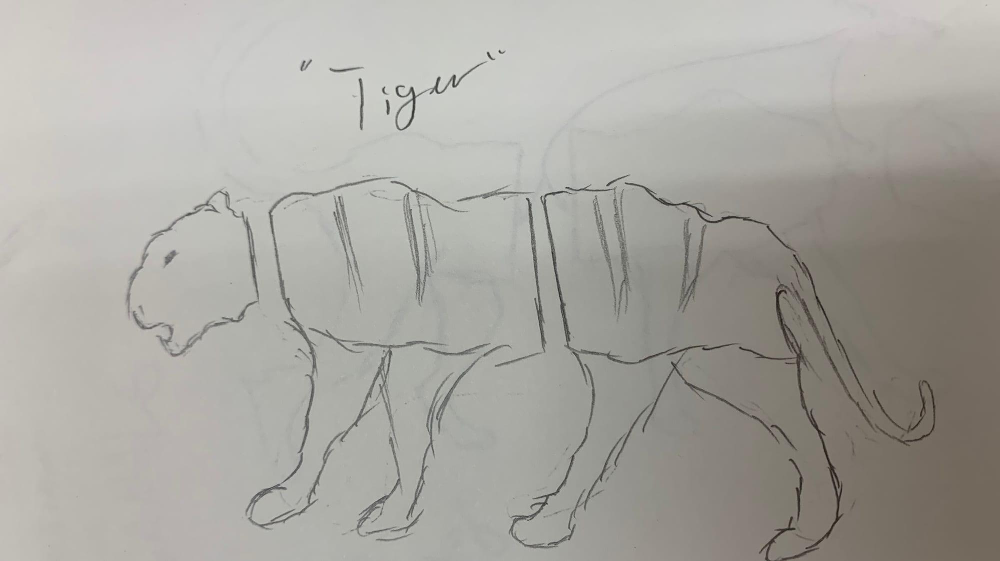

My idea was to create animals that you could hybridize and make your own animals. I proposed this idea to some of the kids I interviewed and they were really into the idea. The pictures above are two animals that could be included for the toy. The halves of the animal could be interchanged as well as the head of the animal. There would be magnets in-between each piece to allow the pieces to stick together while being able to be interchanged. We then held a group discussion with a "Toy Company" where we proposed each of our ideas and decided on one. The idea we decided on is shown below.

# Miniature Mini Golf!

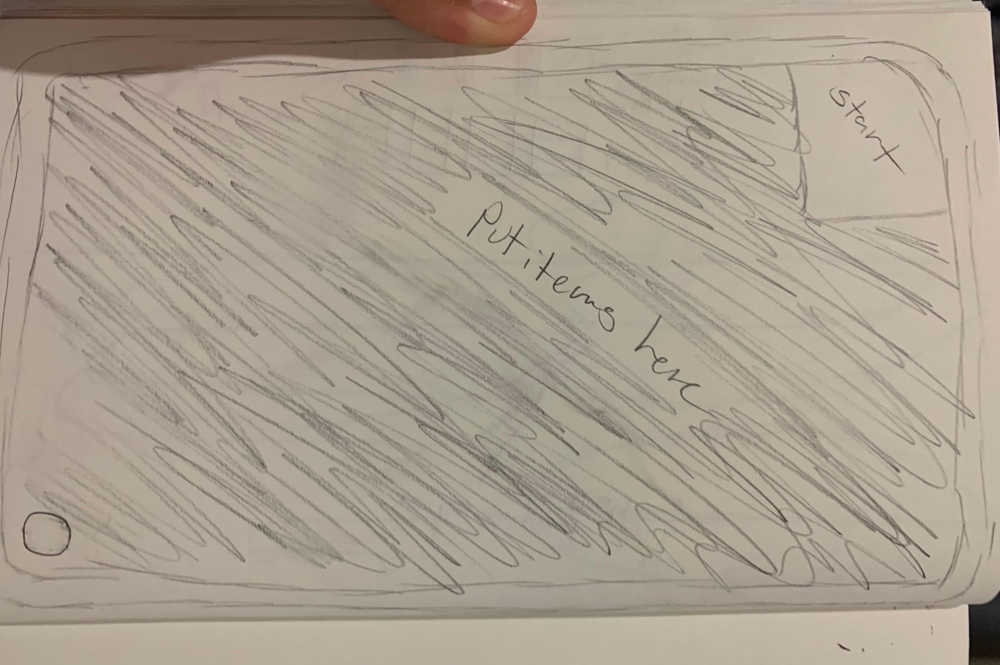

This idea was created by Emile Labrador and our group really enjoyed it because it seemed to tick all the marks that would make a successful toy. It also related to what we found that our kids enjoyed as well as his. The idea is that you can customize and make your own mini golf course. We are planning to create different types of pieces that you can place on the board. The place where you put the pieces will be magnetic and so will the pieces. There will be one generalized starting area and a set end hole. This idea could also support UNSD goal #12 by us being aware of how much materials we use while making this. It will also support goal #8 in spreading the idea of using creativity to create and make up your own ideas.

# Sketches of our Designs (ideate phase)

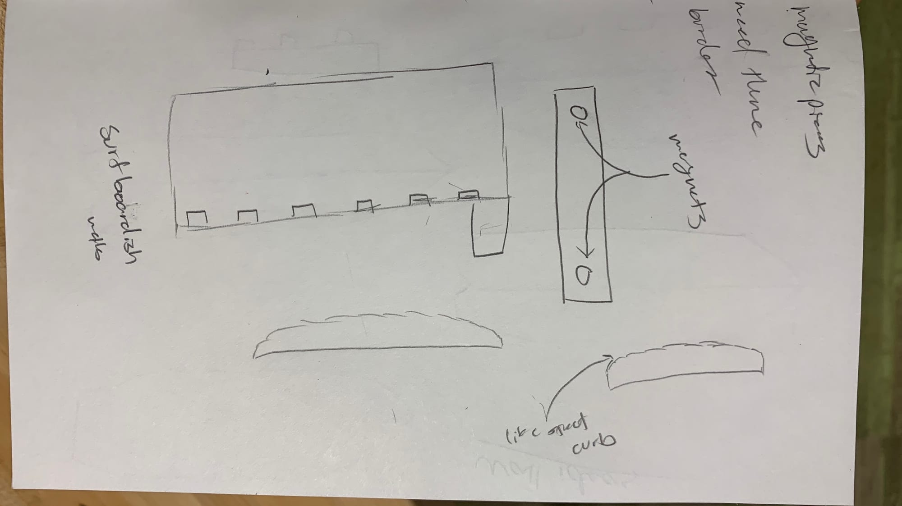

## Early Wall Ideas

This was the first sort of idea for a wall and how it would work. The top left design is what the outer frame of the whole play area could look like. The other designs shown are of the walls that you could place in the play area. We planned to have magnets on the bottom of the wall to stick to the base.

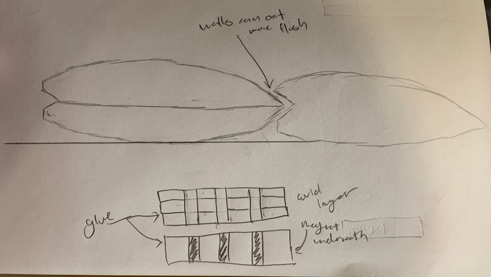

## Later Wall Ideas

We later changed it into this idea because we chose to go with a beach theme so I went for a surf board idea. The sketch on the bottom is an idea to make it thicker and stabler so that the first graders would have a harder time breaking it.

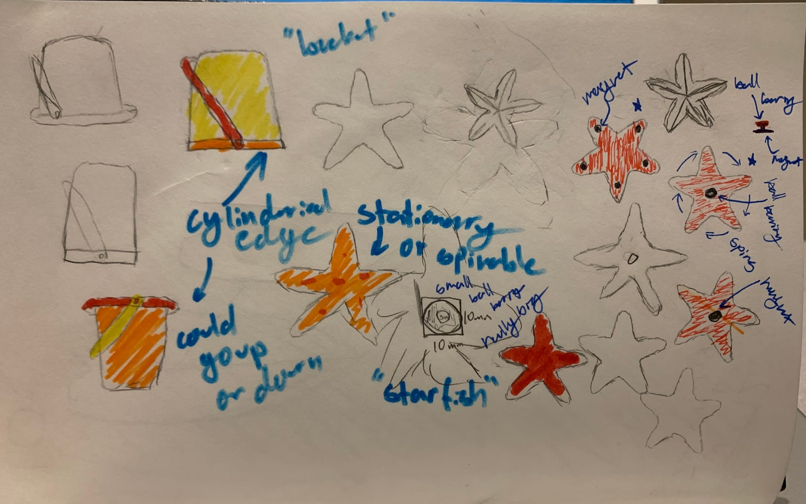

# Quick and Colorful

We have started doing quick sketches with adding color. This helps you to think of things without restraint and make it more fluid and consistent to help new ideas come to be. These ideas here are of a maybe spinning starfish and a cylinder bucket obstacle that our group talked about using and making.

# Time to CAD!

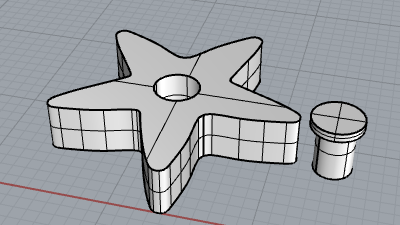

## Spinny Starfish!

This is my design for one of the pieces going into our golf set, a spinning starfish. The figure on the left is the starfish and the figure on the right is the insert that would go in the hole of the starfish. This insert would allow the starfish to spin, and the bottom would be capped off with a magnet.

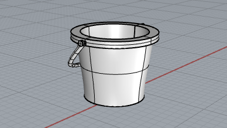

## Bucket Obstacle!

This is a design for a twist on just a simple cylinder piece. We decided that a bucket could be a cool and fun piece to include. This bucket can just be placed anywhere to act as an obstacle. There would be a magnet on the bottom to allow it to stick to the course.

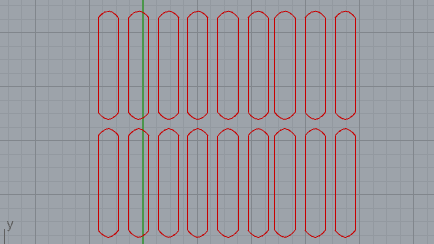

(previous layout for walls)

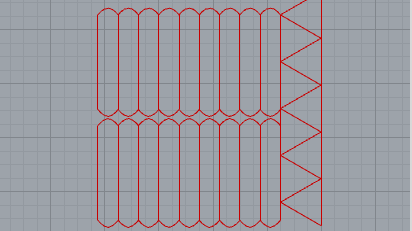

This new layout for laser cutting walls allows for minimal waste and energy use. Save money as well as energy. There is also a layout for a triangle piece.

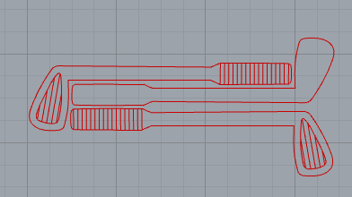

This was the previous design for the golf club and was made to be laser cut. The problem with this design was that it would be extremely easy to break so we had to revise.

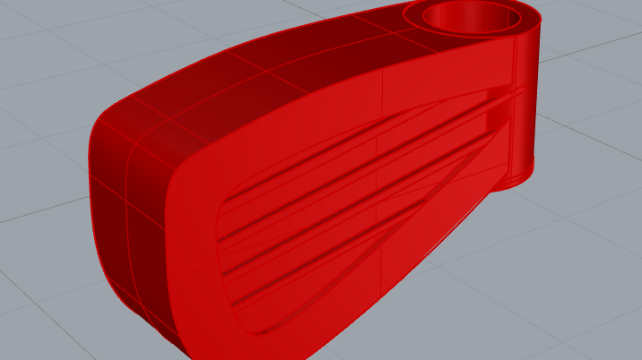

This is what I came up with to be able to create the golf club. This is sort of a sleeve to put on a metal pole which made it sturdier so the first graders wouldn't break it.

# CAD into the real world!

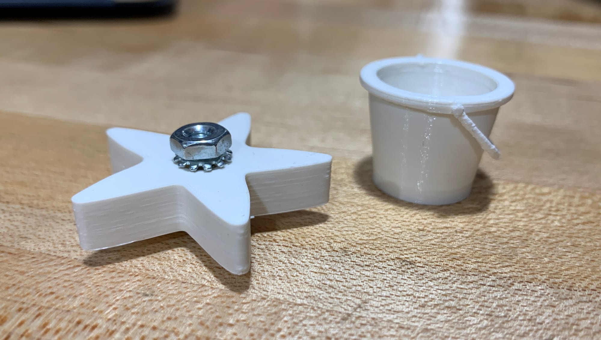

## Bucket and Starfish Done!

This is what the results of the 3D print look like! I think that the bucket came out pretty good as well as the starfish. I added a screw and a nut in the starfish to allow it to spin. I then kept developing how the starfish would spin. I also think that the starfish could be made more efficiently and sustainably with a more reasonable way to spin.

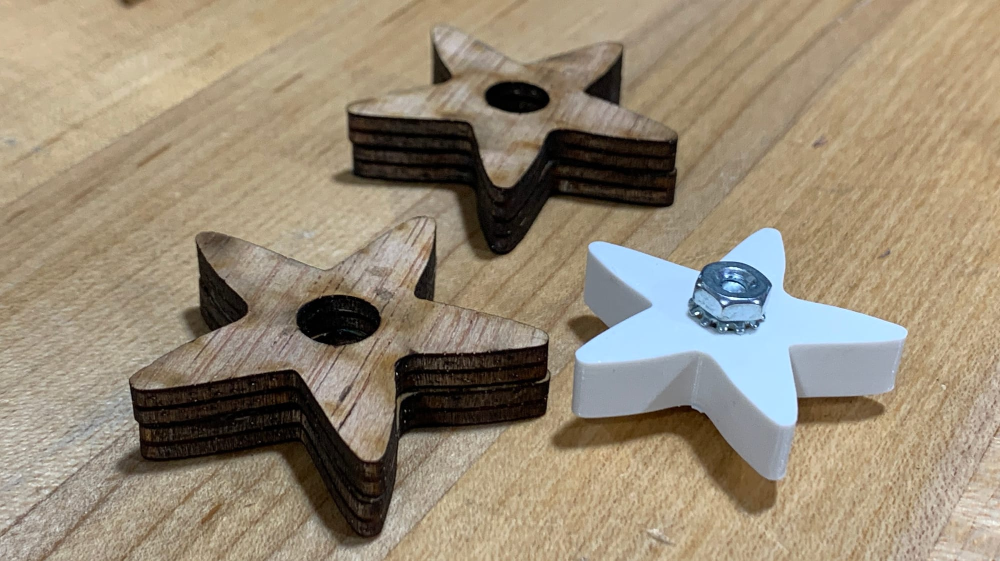

## New and Improved Starfish!

I decided to go for a more resourceful method of making the starfish. Instead of 3D printing I layered pieces of wood together. The middle tube used a similar technique of layering pieces.

# Finished and Painted!

## Final Version of Bucket and Starfish!

We decided to go for a classic starfish and bucket color to make it more recognizable. I think adding this paint job gives it a nice finished look making it seem like an actual product rather than just a random piece of wood or plastic. You can't really tell in the picture but we also added magnetic tape on the bottoms of these pieces to allow them to stick to the base.

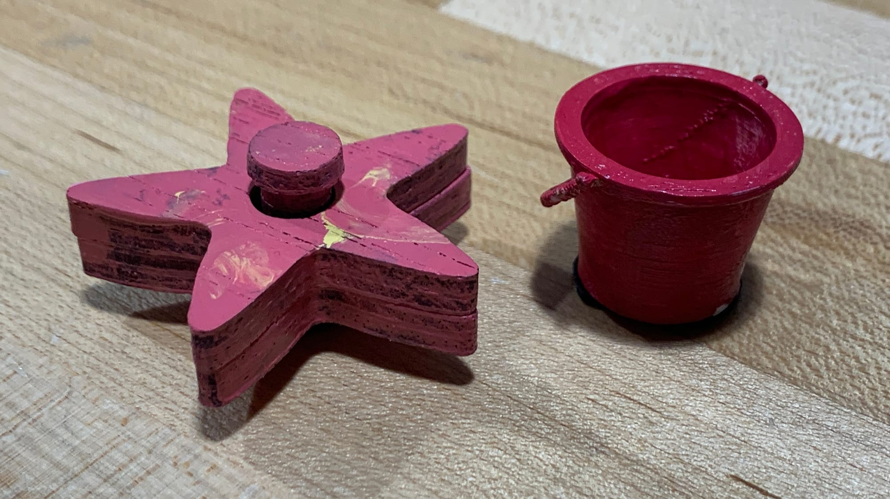

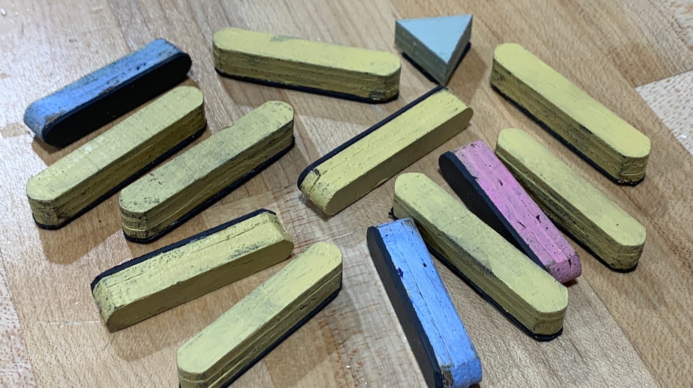

## Great Wall of Mini Golf

Just like the bucket and starfish, the walls have been painted! The magnetic tape has also been added to the bottoms of all the walls. The sand color makes it feel like built up sand in the water which fits the beach theme we were going for! You can also see the triangle piece done and painted.

## Golf Club and Ball

This is what the golf club looks like and ball as well. The sleeve is on a metal pole which gives it a good sturdy structure. The ball is painted to look like a beach ball to give more effect on the beach theme.

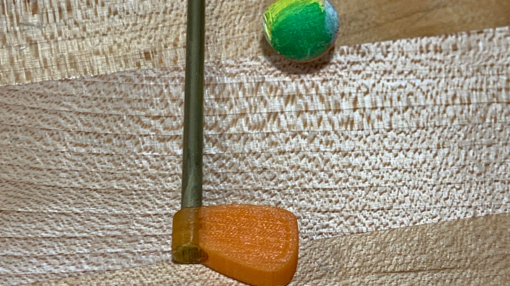

# Finished!

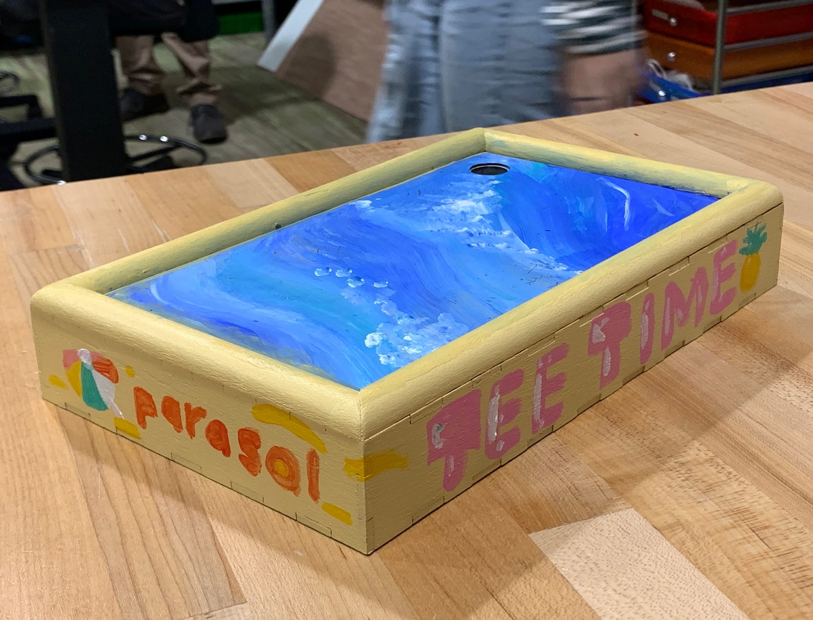

## Beach Vibes...

The base fully painted really brings the entire thing together! With this paint job it really brings together the beach theme we wanted. We also painted our product and company name on the sides to give it more identity relating to us. I think that the kids will really like the look and have fun playing with it!

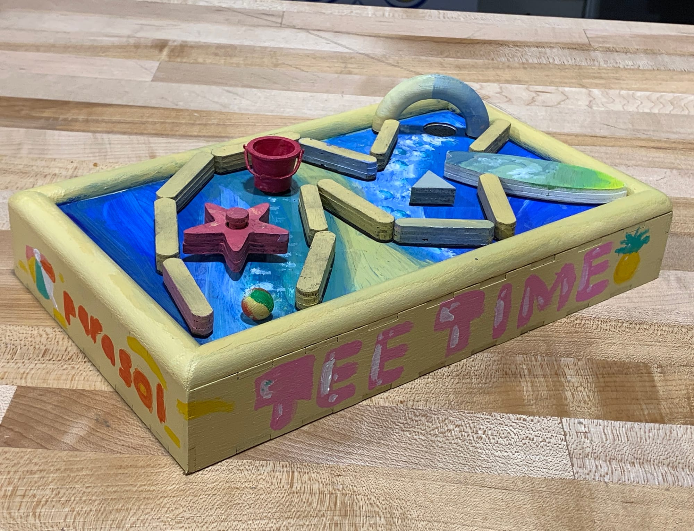

(sample course)

# Duunnn Dunnn... Enter the Shark Tank!

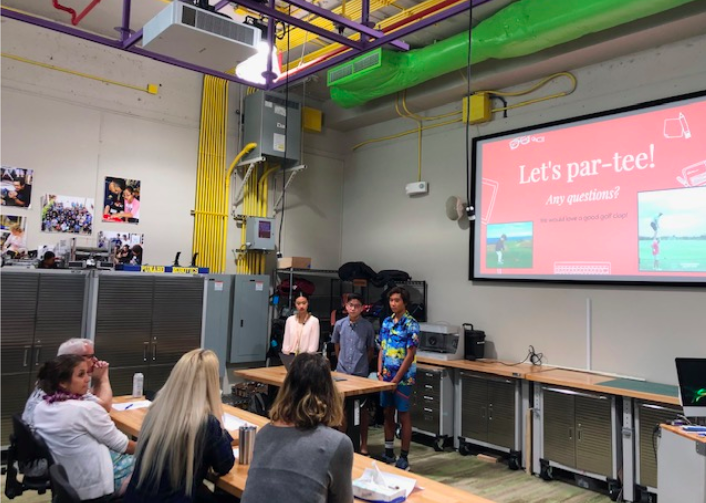

[Presentation (https://docs.google.com/presentation/d/1zyZJmlyYHqh7ovHwyL-JnfSXwdj3s9c8hox_tyvuDjw/edit?usp=sharing)]

## Par-tee time!

The last step of this process was to propose this toy to a group of four "Sharks". Mr. Swanson said these people are "giants in their field." They are all very qualified to be a Shark and judge of our toys. While creating this presentation I had a personal goal of putting in a good amount of puns. The judges seemed to enjoy these jokes and the creator of SOHA Living said "this presentation was definitely the most entertaining." We also held a practice presentation in our GSD Large class. In these presentations they said that there were too many puns but I still think it turned out well. I think the presentations went well and we also got some helpful feedback if we were to continue to manufacture this toy. The main piece of feedback was to have the box open and allow storage and also to make some sort of pamphlet to promote the UNSDGs. This is definitely something we could easily change in the future.

# The Final Opinion

## How did the First Graders like our toys?

When the first graders saw our toys they went crazy and were super excited to play with them all. They were trying to get the toys while the teacher was trying to explain what they were to them. We all hope that the kids will continue to appreciate our toys because we put a lot of time and effort into them!

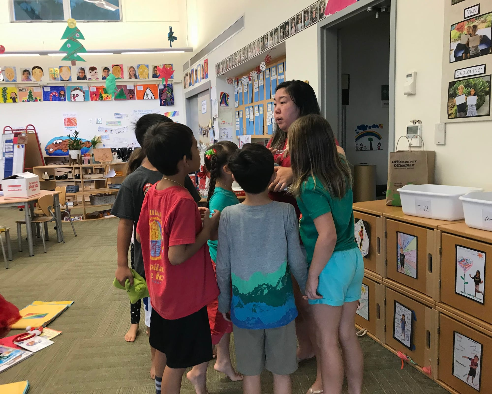
