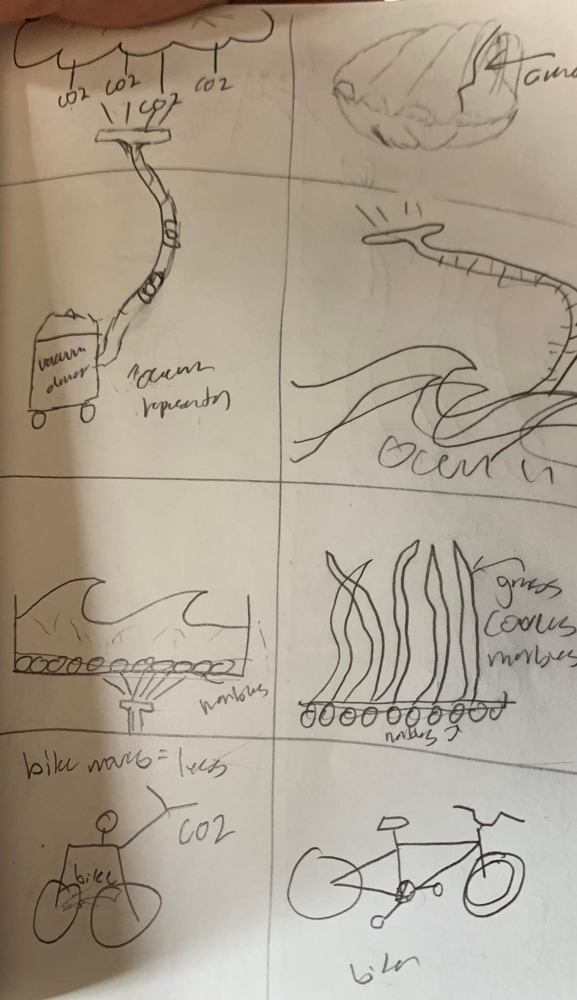
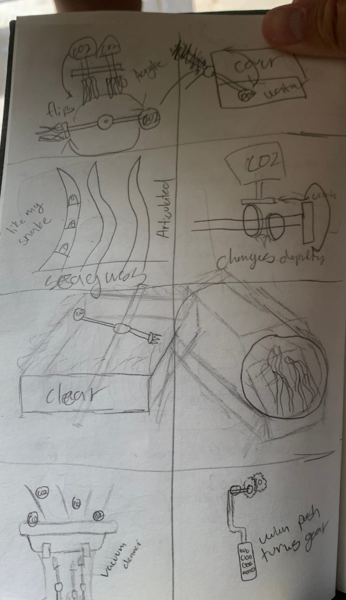
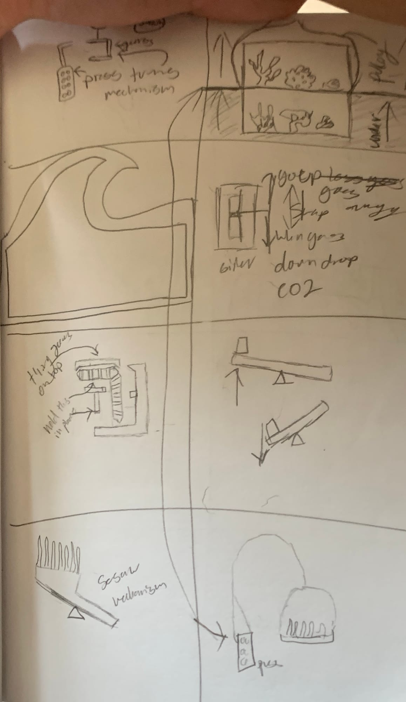
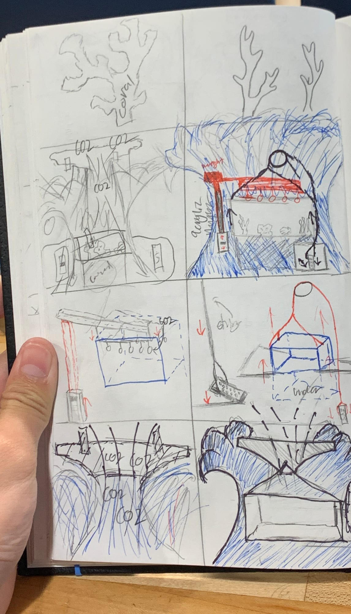
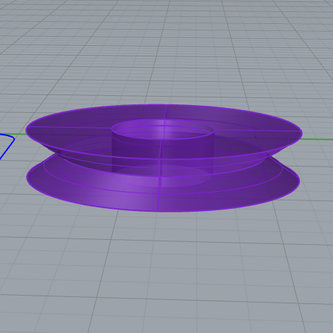
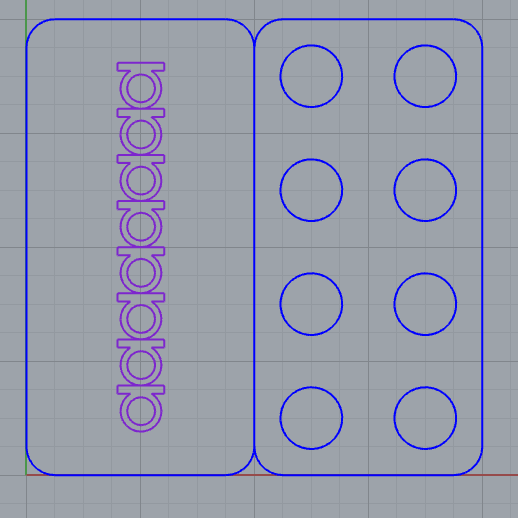
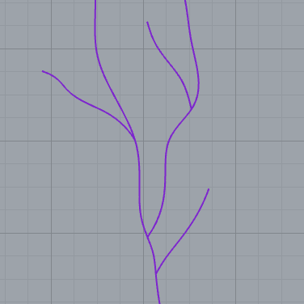
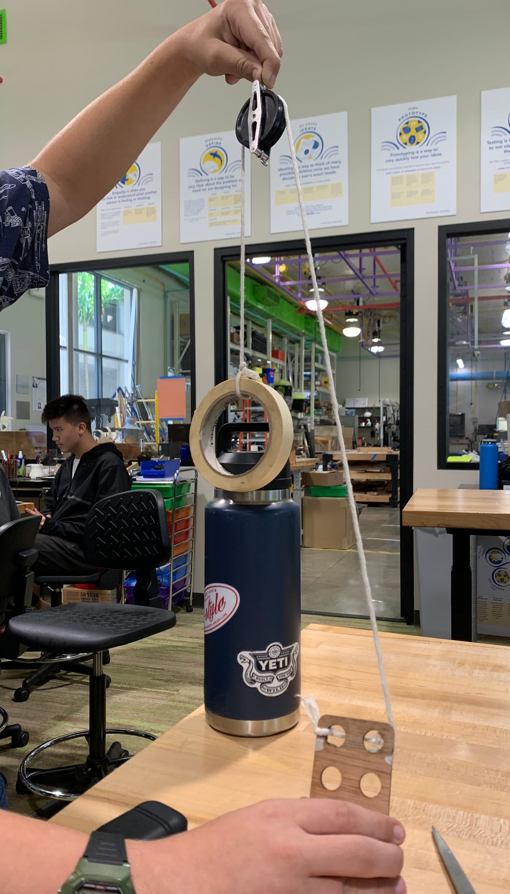
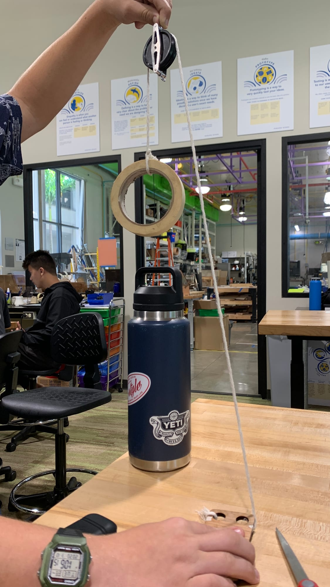

## Vital Sign : Ocean Acidification

I think ocean acidification is a problem that needs to be focused on because of the threat it poses to our island chain. Ocean acidification is where the ocean takes in too much CO2 from the air. The ocean naturally takes in around a quarter of the CO2 in the air but as the amount of CO2 in the air increases so does the amount that the ocean intakes (NOAAPMEL, 2012). This can cause a total change in ecosystems and affects around a billion people on this earth. This is an issue for us living on this island chain because it can affect reefs and wildlife around us. Ocean acidification affects the amount of carbonate materials in the water which are essential for things like coral and shellfish to reproduce or grow (NOAAPMEL, 2012). One thing that ocean acidification does is contribute to the bleaching of coral (Andersson, 2013). If nothing is done the coral will have an extremely low chance of surviving. There are many developing approaches to help solve this coral-reef issue by monitoring the carbonate materials in the water (Lantz, 2014). Also, the amount of CO2 in the ocean affects how successfully shellfish can reproduce which can hurt a large industry. It was found that the world could lose over 100 billion USD from the lessened amount of mollusks or shellfish (Narita, 2012). People also have not found a way to artificially help shellfish to reproduce more efficiently. I feel that this is an urgent issue that should be addressed and the core of the issue starts from the amount of CO2 we as people produce so I think we need to figure out more efficient ways to do everyday tasks allowing the solving of this urgent issue for our islands. Some ways that are being thought about include planting more seagrass, just adding meadows of seagrass could up coral growth by 18% (Nicola, 2016). This would be minimally labor intensive as well as give the various sea creatures more areas to live and forage. I think if we can implement some ways to counteract the effects of ocean acidification our islands will be healthier as a whole.

Works Cited

What Is Ocean Acidification?, www.pmel.noaa.gov/co2/story/What is Ocean Acidification?

Andersson, Andreas J. “Ocean Acidification and Coral Reefs: Effects on Breakdown, Dissolution, and Net Ecosystem Calcification.” Annual Reviews, www.annualreviews.org/doi/abs/10.1146/annurev-marine-121211-172241.

Narita, D., Rehdanz, K. & Tol, R.S.J. Economic costs of ocean acidification: a look into the impacts on global shellfish production. Climatic Change 113, 1049-1063 (2012). https://doi.org/10.1007/s10584-011-0383-3

Nicola Jones, et al. “How Growing Sea Plants Can Help Slow Ocean Acidification.” Yale E360, e360.yale.edu/features/kelp_seagrass_slow_ocean_acidification_netarts.

Lantz, C.A., Atkinson, M.J., Winn, C.W. et al. Dissolved inorganic carbon and total alkalinity of a Hawaiian fringing reef: chemical techniques for monitoring the effects of ocean acidification on coral reefs. Coral Reefs 33, 105-115 (2014). https://doi.org/10.1007/s00338-013-1082-5

# This draws the line...

First set of thumbnail sketches. Messing with ocean and vacuum idea.

Second Set. I am looking at ways I can create movement in my piece.

Third Set. I am still looking into ways to create simple movement.

Fourth Set. I figured out a solid idea and two ways to show movement.

# Prototyping and CAD!

## Pulley

This is the pulley I made for one of the kinetic movements parts.

## Gas Pedal

This gas pedal controls the pulley.

## Coral

This is what the coral pieces would look sort of like.

# Pulley in Action

As you press down on the gas pedal the thing on the other end will move. This will be essential for the scene of my sculpture to be able to change.

## Reflection!

One obstacle that came up was trying to figure out how to make the sculpture feel connected. I knew parts that I would need to include but struggled to find a good way to make everything feel connected. If we were to continue with this product I would make more changes on what I would be putting my simple machines inside of. The idea that I had could be improved and bettered. I think the most successful part of this project was trying to figure out how to make it kinetic. This made you have to be more creative in creating machines and incorporating them into a design. I think that if we were to go back to school next year I would not continue this project because I feel like I gained some knowledge on how to make some simple machines like a pulley but could use the time to learn more things.
