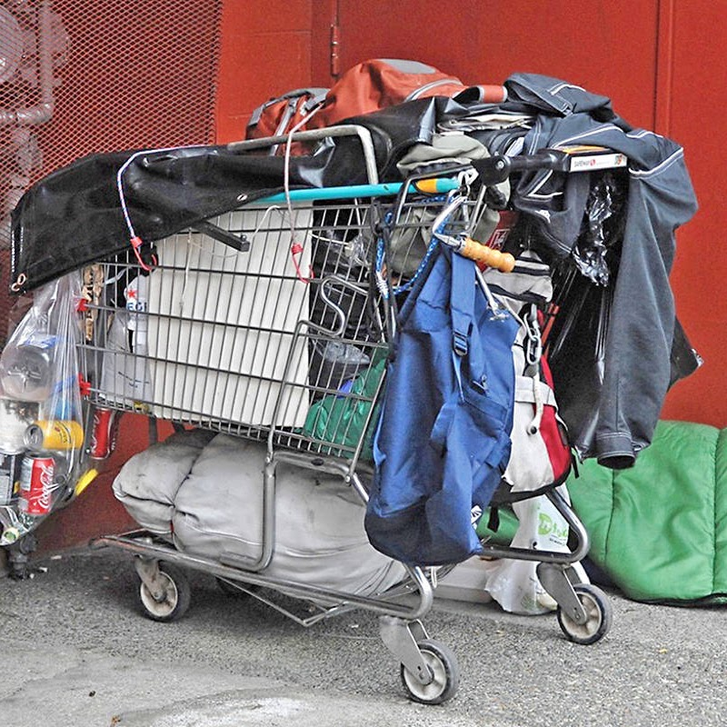
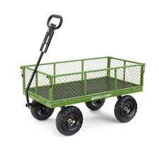
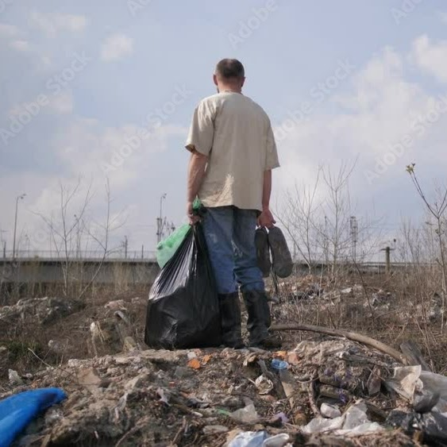
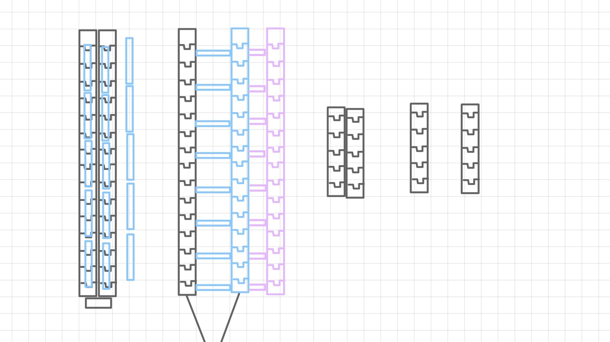
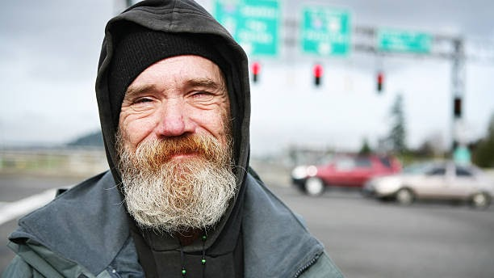

# Ku Hala

We wanted to figure out a way to help make the homeless community's lives just a little bit easier. We want to ease the load of carrying all their belongings on their back.

# Current Carrying Methods

## Shopping Cart

## Four Wheel Cart

## Hand Held

# Our Idea

We wanted to create a portable yet sturdy cart-like device. We will create two jointed rectangles that can be pulled apart and turned into a cart-like device. Each joint will have a wheel to keep it stable while being able to bend and turn with the terrain beneath it.

# Inspiration

We took our joint idea from various 3D printed articulated animals.

# Reach

# Community Outreach

We hope to give these out to the community, including the homeless, and take a worry and ease off of their life.
