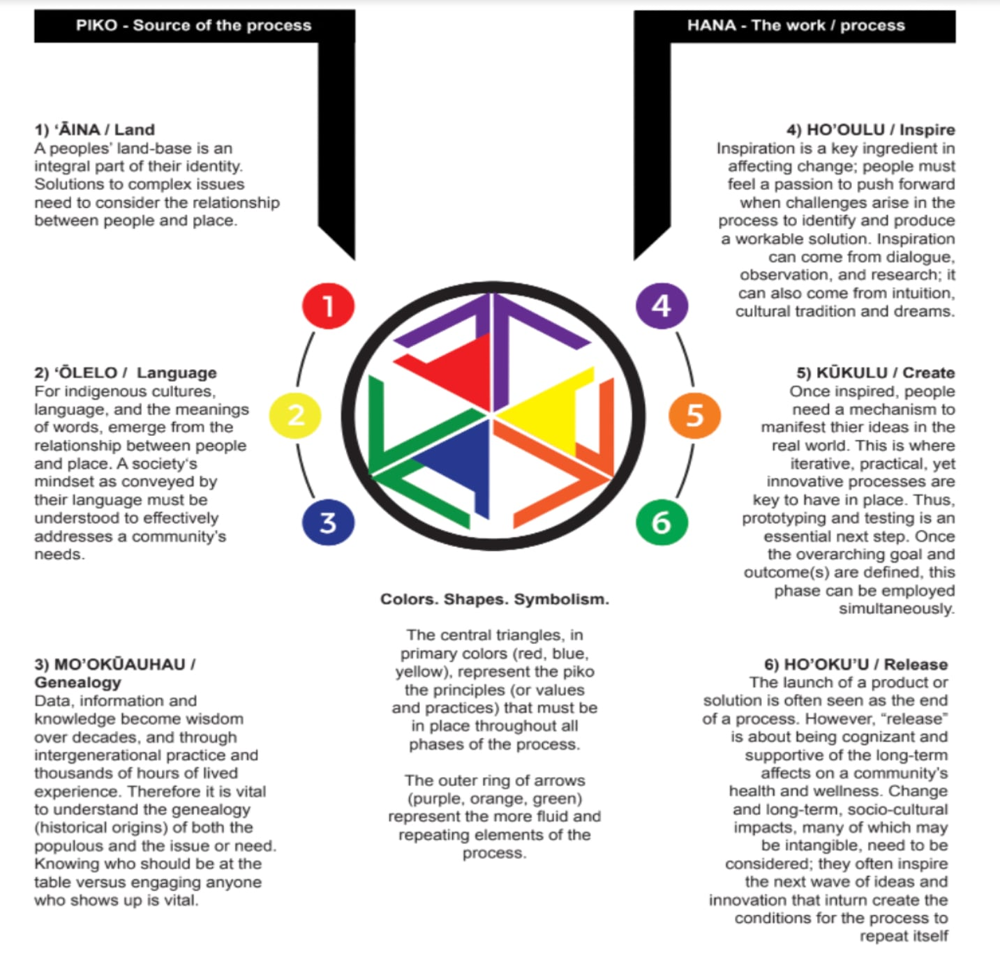
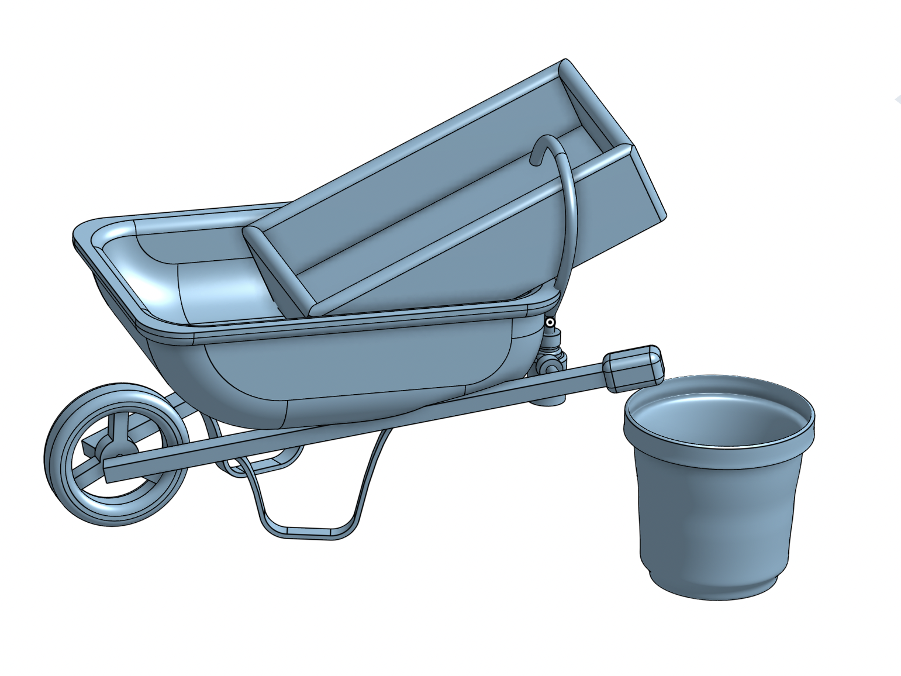
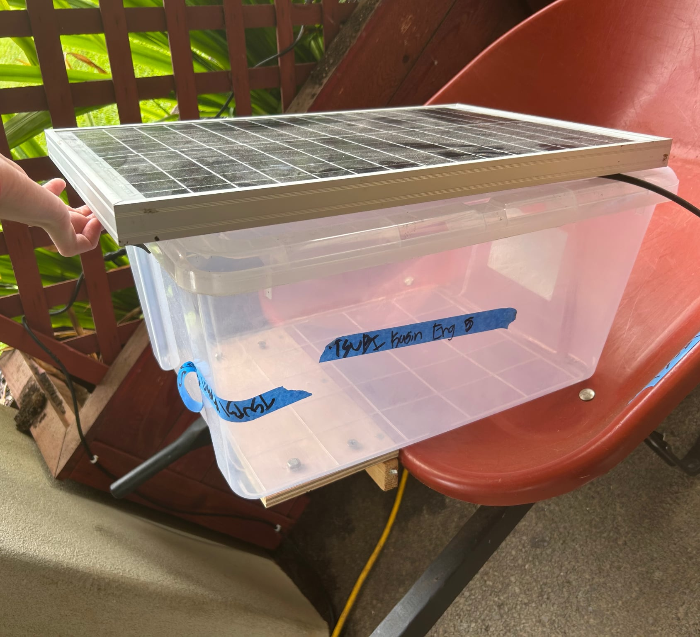
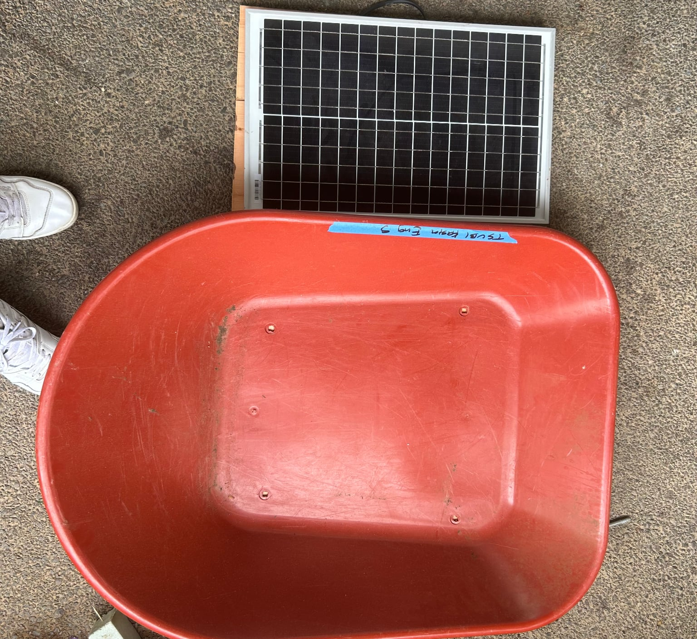
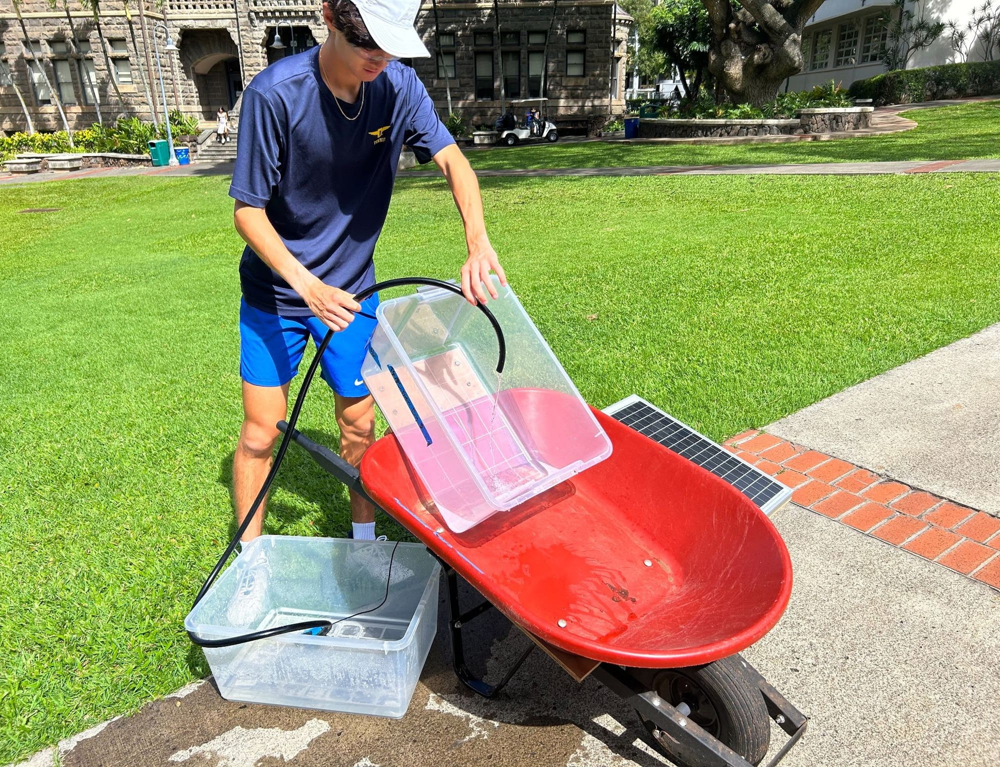
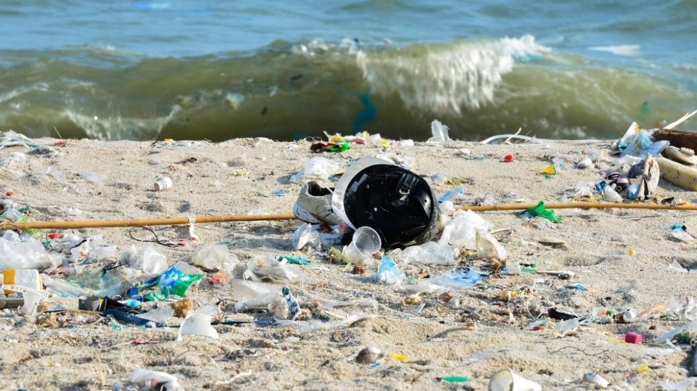

# Ku Hala

We wanted to figure out a way to help out the beach environment to keep it a nice, safe place. Some of the beaches have lots of trash and this makes the overall environment messy. In order to prevent this, we are planning on making our own sand filter design that collects all the trash efficiently and effectively.

# Our Idea

We hope to make a moving sand filter that will sift through micro-plastics and trash. Our design will consist of multiple small rechargeable units that everyday beach goers can bring along with them and clean the beach where they settle down. There will be one central charging station powered by solar panels. The people who clean the beach can bring their collected trash and unit back to the station and record the amount of trash they collected.

# Inspiration

This is one of the most common designs and we want to make something similar but smaller, portable, and unique.

# Budget

| Item | Size | Cost |
| --- | --- | --- |
| [Aluminum sheets](https://www.mcmaster.com/metals/aluminum/oversized-multipurpose-6061-aluminum-sheets/) | 24" x 24" | $220 |
| [Aluminum 90º angled tube](https://www.mcmaster.com/metals/aluminum/polished-multipurpose-6061-aluminum-90-angles/) | 1/2", 4' | $22 |
| [Solar panel](https://www.mcmaster.com/solar-panels/) | 19" x 10" | $30 |
| [Compact DC motor](https://www.mcmaster.com/motors/compact-dc-motors/) | 12 V DC | $122 |
| [Mesh](https://www.mcmaster.com/mesh/stainless-steel-wire-cloth-9/) | 1' x 1' / 4' x 4' | $13 / $155 |
| [Battery](https://www.mcmaster.com/batteries/long-life-sealed-large-cell-batteries-for-continuous-use/) | 12 V DC | $32 |

# Timeline

**First semester**

- Design and CADing
- Prototyping
- Gather all materials
- Possibly start building

**Second semester**

- Continue/Finish building
- Go to the beach/test out the design, and interview beachgoers
- Rebuild based on feedback and test again (repeat if needed)
- Finalize our project for release

# CAD

Here is the CAD for our design, we hoped to make it portable and something easily created by others.

This was the first option we tried when using the solar panel (left). The idea we decided on would be to sandwich a board beneath the wheelbarrow and lay the solar panel on it (right).

# In motion

Our system proved successful as the solar panel provides enough power to successfully pump water from a bucket to our top sand filtering bucket.

# Release

## Environment & Community

Create a more efficient way to clean up our beaches and stop the trash from entering the ocean in the first place, especially in Hawaii. We want to set these up across our islands' beaches and allow common beach goers to easily begin cleaning their beloved beaches. We can connect our system to a citizen science app and have them track how much and what kind of trash they collected.

## Ideas from our feedback

- Build with PVC
- Shield the motors for safety
- Sift water and wet sand, not just dry sand
- Catch pieces down to 5 mm to get micro plastics
- Add a door on the filter to clear blockages
- Make it safe for kids, and maybe add a game for kids
- Fix lubrication issues
- Try a full water based system
- Waterproof the battery
- Use physics for a siphon instead of a water pump
