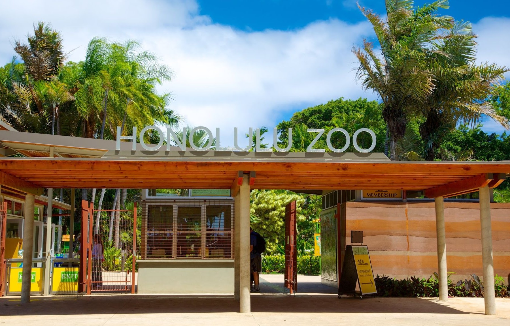
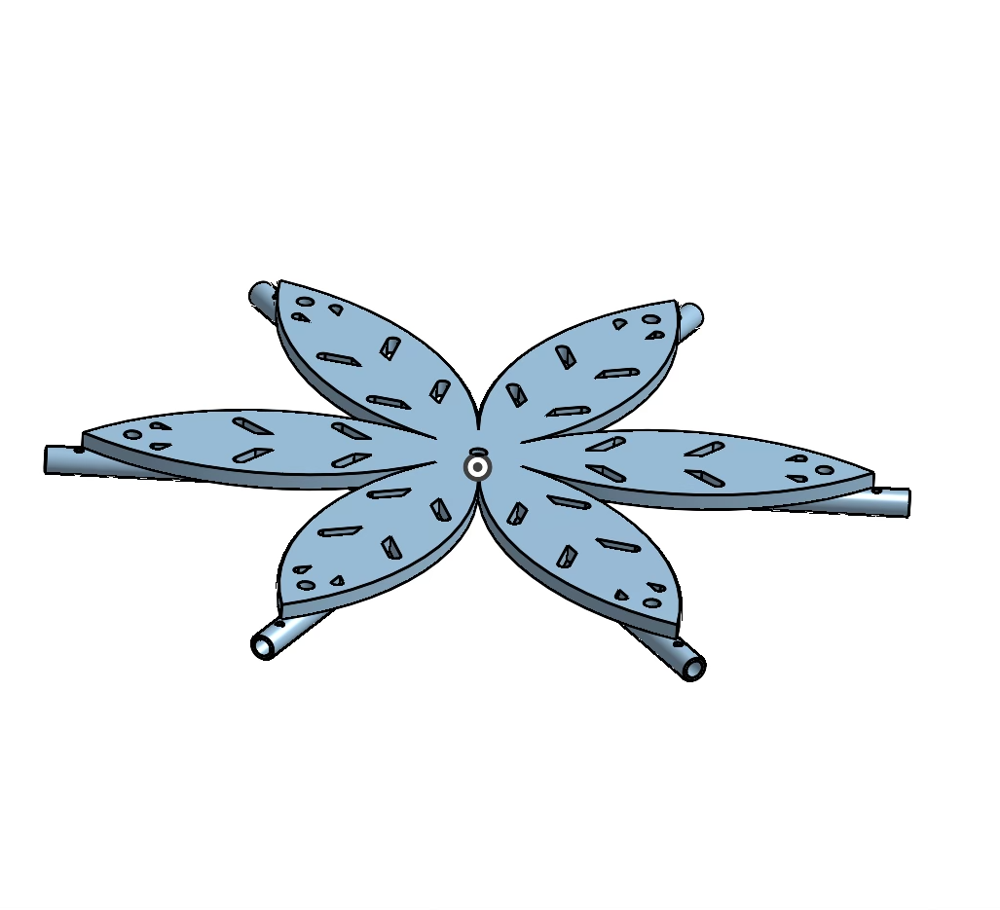
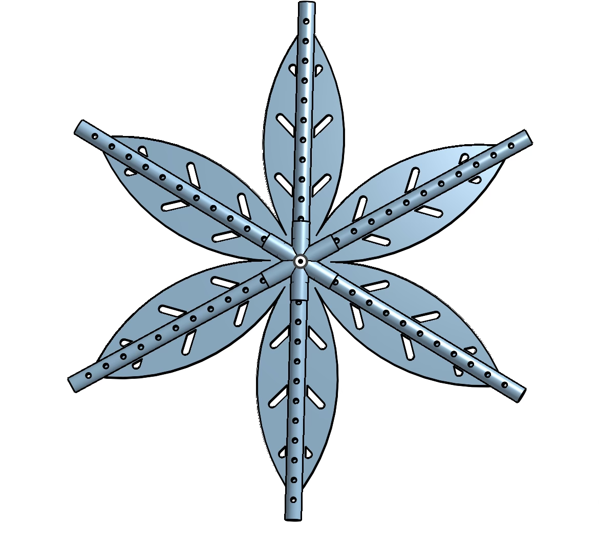
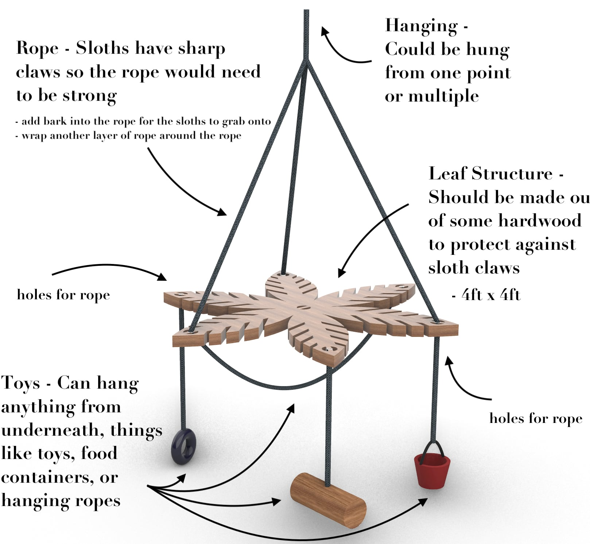
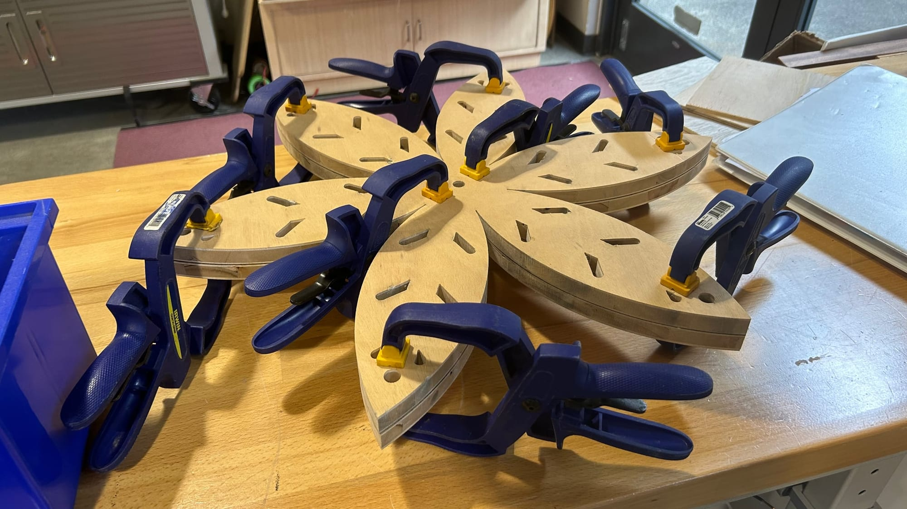
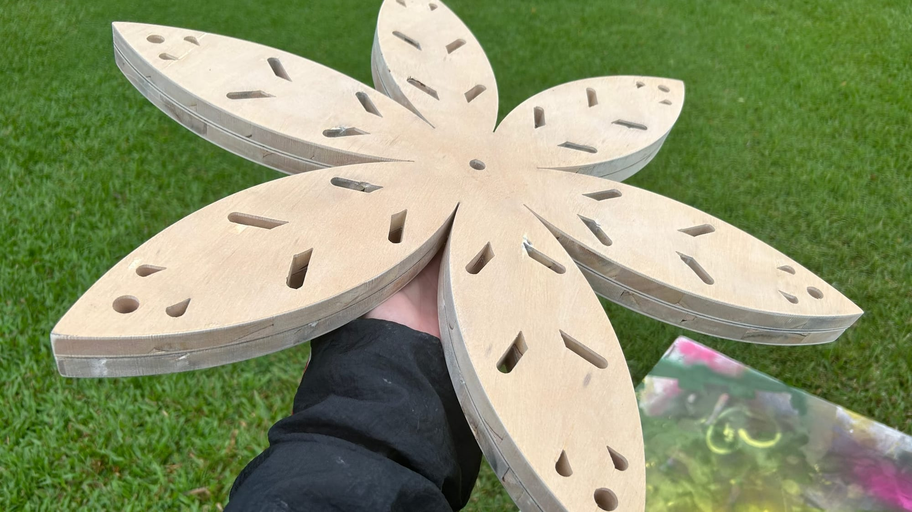
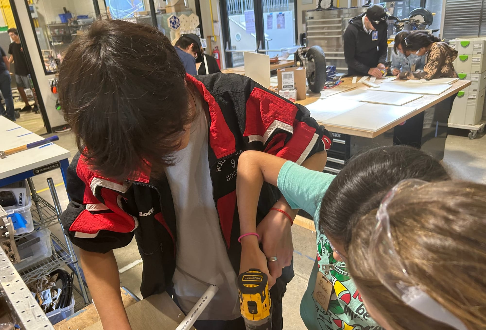
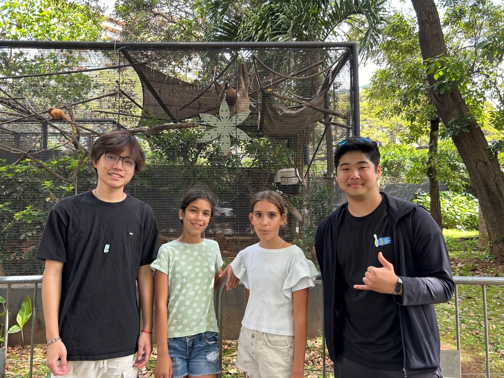
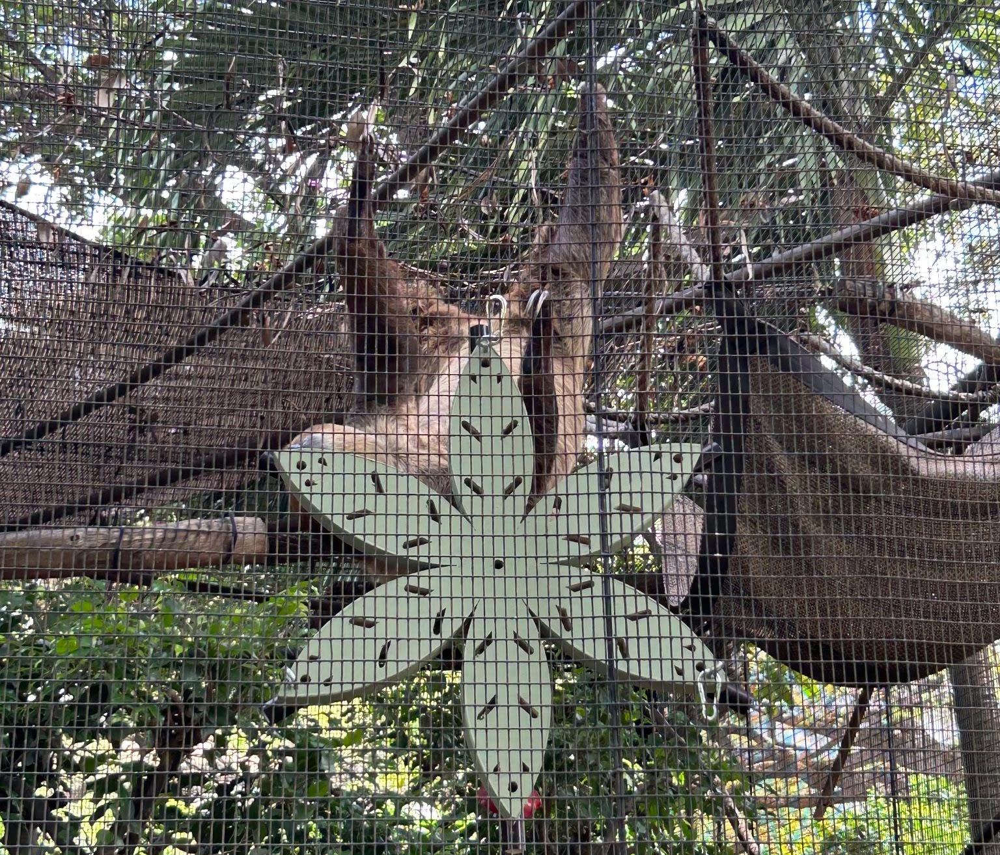

# Zootopia

The Waikiki Zootopia project aims for us to collaborate with fifth graders at Waikiki Elementary School to create enrichment toys for the animals at the Honolulu Zoo. My partner and I were paired with two girls from Waikiki Elementary who wanted to make a toy for a sloth. They tasked us with creating a hanging leaf structure that could hold food for the sloths.

# CAD

# Finished CAD

This is the CAD that we sent to the kids at Waikiki Elementary. We included potential toys and a PVC pipe where they would be allowed to hang food off of for the sloth to eat. We received feedback and went back and forth with both the students and a zookeeper at the Honolulu Zoo on what to change.

Gluing Process

Finished product

# Working together

The Waikiki Elementary kids eventually came to our school and together we added the finishing touches to our product! It was an extremely educational process working alongside younger students. This entire process reminded me that engineering is made for an audience. Before this project, all of the client work we have done had been with other humans but now I was creating something for an animal. Animals are unable to meet over a Zoom meeting or speak to us in person which made this a new and exciting process for me.

# Final Product

The creation was a success and we were able to see our final enrichment toy in use at the Honolulu Zoo! The sloth was able to successfully interact with the toy using it to eat food off of. Visiting alongside the Waikiki Elementary kids was an extremely positive experience for me as I was able to see how excited the kids were to see something that they worked extremely hard on in use. The kids had told us that they wanted to do more engineering-related work and it was inspiring to see the impact we had on them and their future.
