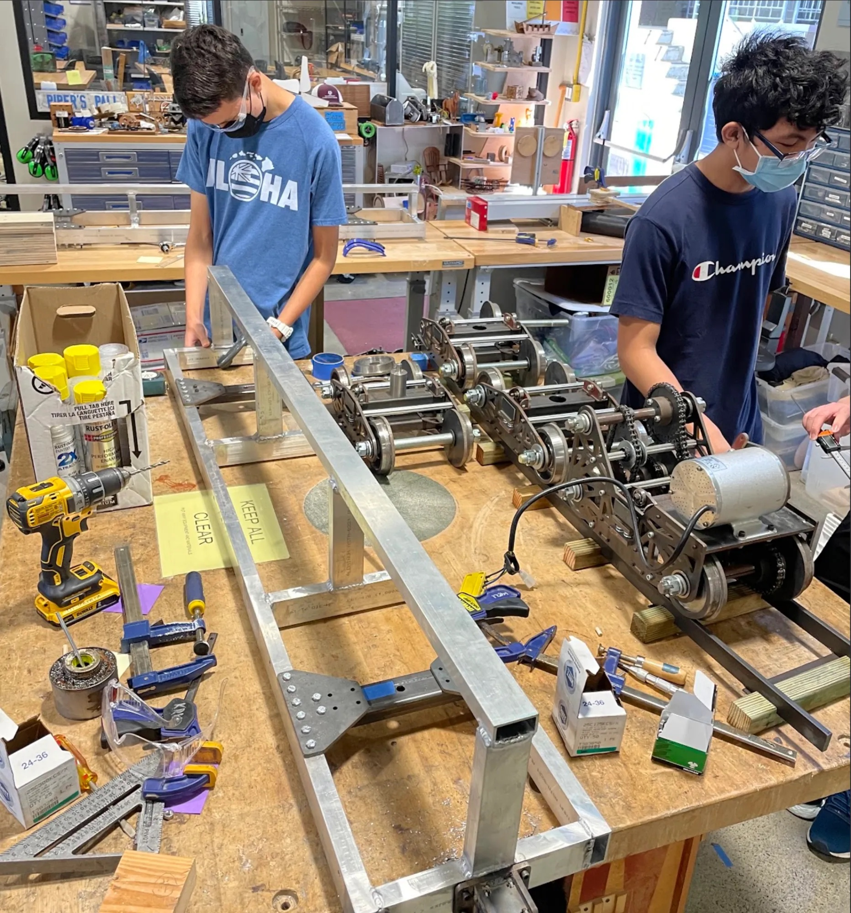
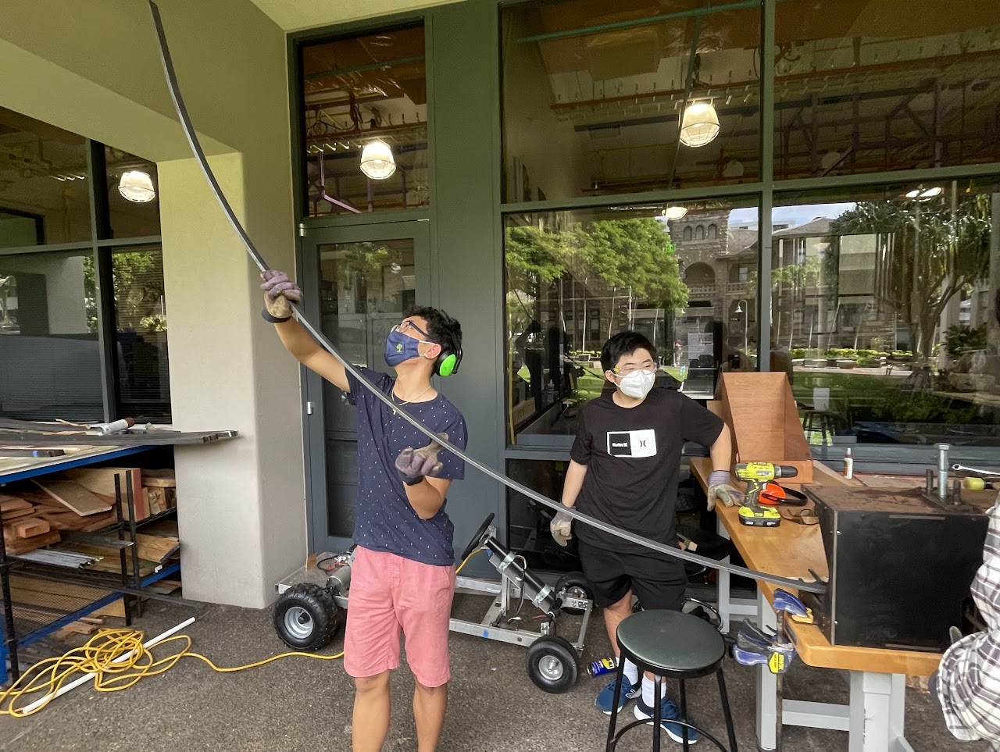
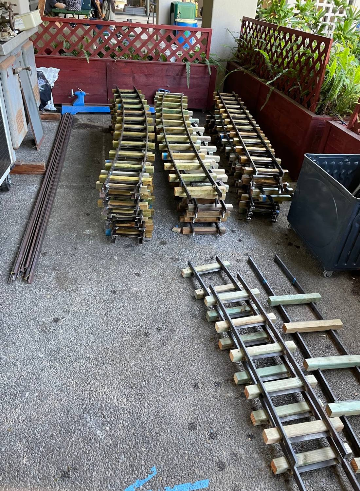

The Lanakila Express is a ride-on electric train for kids, built by our Engineering IV class over two years. We designed every part ourselves: the cars, the bogies, the track and a solar charger that keeps its batteries topped up. With the usual carnival rides canceled during Covid-19, the train was the only ride, and at the 2022 Punahou Carnival it carried hundreds of kids around its track.

# How the work was split

The class was split into 8 teams of 3 or 4 people. Each team owned its own part of the train, and every team also picked up jobs the whole class shared.

My part of the build:

- **[Solar charger](/punahou/lanakila-express/solar-charger/).** The charger was designed to turn so its panel could face the sun. Kaden and I worked on its handle and wheel. Our team also prototyped the leg bracket to check its size and hole placement, then used the prototype as a template to drill the legs.
- **[Couplings](/punahou/lanakila-express/couplings/).** I helped make the couplings that join the track sections, using the horizontal bandsaw and the mill.
- **Track bending.** I helped roll the steel flat bar into curved rails on the class-built roller bender.
- **[Tracks](/punahou/lanakila-express/tracks/).** Once the straight and curved sections were built, the rails didn't line up where they met. We made a connector section so the train rolls smoothly over each joint.
- **Carnival.** At the 2022 carnival I rode the train and took photos of it running.

# The cars

*A car frame in front, with the bogies behind it. The bogie on the right carries the drive motor and chain.*

Each car frame is aluminum rectangular tubing, welded together, with steel brackets and hitches. The bogies under the cars are built from waterjet-cut steel parts. The wheels were machined on the Haas CNC mill.

# The track

*Curving steel flat bar on the roller bender we built for the track.*

The rails are steel flat bar, and the class built its own roller bender to curve them. Making a section took six steps:

1. Roll the flat bar into a curve on the roller bender.
2. Cut the wooden ties to length.
3. Cut the rails and the angle iron tie brackets on the vertical bandsaw.
4. Install the couplings.
5. Assemble the section and weld it.
6. Oil and stain the section so it holds up outdoors.

*Finished curved sections stacked up, with straight sections still being put together in front.*

# Materials

These come from the class bill of materials.

| Part | Material | Size |
| --- | --- | --- |
| Rail | Mild steel flat bar | 1.25 × 3/8 in |
| Coupling | Steel angle iron | 1 × 1 × 1/8 in |
| Tie bracket | Steel angle iron | 3/4 × 3/4 × 1/8 in |
| Tie | Douglas fir | 2 × 2 in (1.5 × 1.5 in actual) |
| Car frame | Aluminum box tubing | 1 × 2 in |
