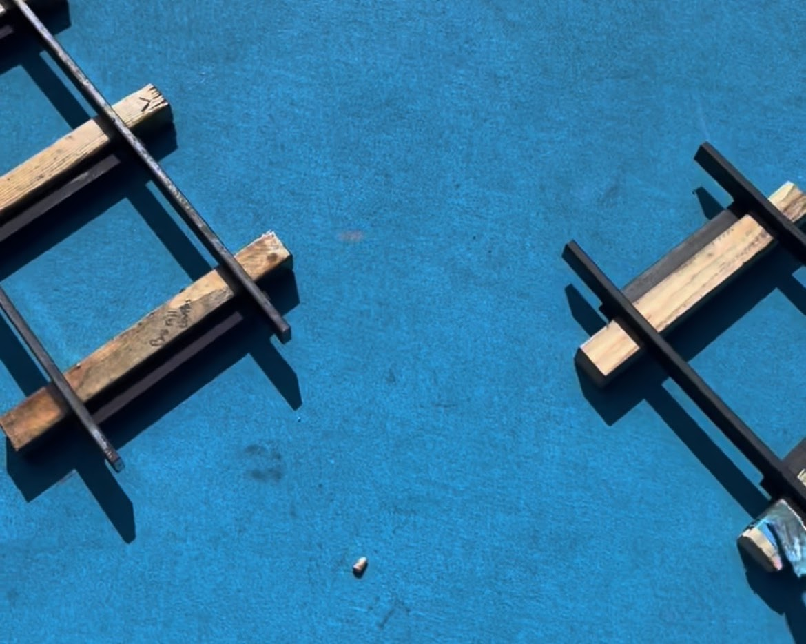

# Issues

After we had created the straight and curved pieces of track, we found that there was an issue on the connecting points of the track. We had to create another piece of track to be a connector between the straight and curved pieces, so the rails would line up and the train could roll smoothly across each joint.
